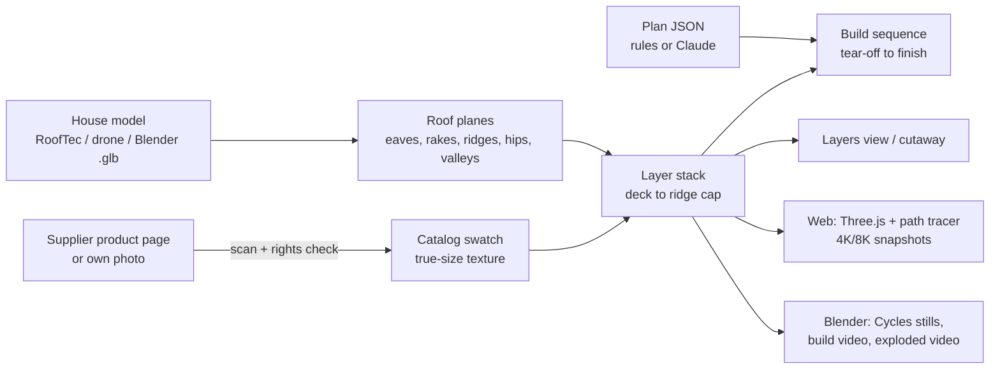

# Open-source tools for RoofTec 3D homes

What this repo now uses, what is worth adding next, and which licenses to watch. Licenses were checked in November 2026 against each project's LICENSE file, README or package registry entry; re-check before shipping a product.

## Pipeline

- `roof-visualizer/`: browser app for the sales conversation and fast iteration.
- `roof-blender/`: Cycles renders for marketing-grade stills and video.
- Both read the same plan JSON and build the same layers, and GLB files move between them in both directions.

## In use now

| Component | License | Role |
|---|---|---|
| three.js 0.186.1 | MIT | WebGL viewer, PBR materials, shadows, GLTF import/export |
| three-gpu-pathtracer 0.0.27 + three-mesh-bvh 0.9.16 | MIT | Progressive path-traced stills in the browser |
| blender-mcp (ahujasid) | MIT | Claude drives Blender (this repo's other skills use it too) |
| Blender 4.2 / 5.x | GPL-3.0 (application) | Cycles rendering. Your renders are yours. Blender's own position is that scripts calling its Python API (like `roof_core.py`) fall under the GPL if you distribute them; using them in-house and selling the renders is unaffected |
| Poly Haven HDRI "Kloofendal partly cloudy" | CC0-1.0 | Optional photographic sky |
| @anthropic-ai/sdk (optional) | Apache-2.0 | Claude-written build plans |
| Procedural textures, geometry, server | written for this repo | No third-party assets; no image licensing questions for built-in products |

## Worth adding next (MIT unless noted)

| Project | License | What it would improve |
|---|---|---|
| [building_tools](https://github.com/ranjian0/building_tools) | MIT | Fast walls, windows, doors and roofs in Blender for houses without a scan |
| [Material Maker](https://github.com/RodZill4/material-maker) | MIT | Author higher-fidelity shingle, metal and tile materials, export PBR maps to the catalog |
| [NormalMap-Online](https://github.com/cpetry/NormalMap-Online) | MIT | Better normal/displacement maps from a single swatch photo than the built-in Sobel filter |
| [Unity-WebGPU-PBR-Maps-Generator](https://github.com/aniketrajnish/Unity-WebGPU-PBR-Maps-Generator) | MIT | Height, AO, roughness and metallic from one photo; its shaders can be ported to the viewer |
| [GaussianSplats3D](https://github.com/mkkellogg/GaussianSplats3D), [Spark](https://github.com/sparkjsdev/spark) | MIT | Show a drone capture of the real house (trees, driveway, neighbors) around the rebuilt roof |
| [xatlas](https://github.com/jpcy/xatlas) / xatlas-web | MIT | Clean UVs on photogrammetry meshes before texturing |
| [meshoptimizer](https://github.com/zeux/meshoptimizer), [glTF-Transform](https://github.com/donmccurdy/glTF-Transform) | MIT | Compress house and layer GLBs 5-10x for faster loading on phones (the viewer already decodes meshopt) |
| [straight-skeleton v1](https://github.com/StrandedKitty/straight-skeleton) (npm 1.x) | MIT (ported from Apache-2.0 code; keep the notice) | Generate hip roofs from a building footprint in the browser |
| [That Open Engine](https://github.com/ThatOpen/engine_components) | MIT | Open IFC/BIM models from builders and architects |

Permissive but not MIT, also fine for commercial use:

| Project | License | Use |
|---|---|---|
| COLMAP | BSD-3-Clause | Camera poses and dense meshes from drone photos |
| gsplat, nerfstudio | Apache-2.0 | Train Gaussian splats of a house from a drone flight |
| SAM 2 | Apache-2.0 | Mask the roof in site photos (for photo-based previews and damage marking) |
| Depth Anything V2 **Small** | Apache-2.0 | Depth from one photo. The Base/Large/Giant weights are CC-BY-NC-4.0: not for commercial use |
| Poly Haven, ambientCG assets | CC0-1.0 | Textures and HDRIs with no attribution required |
| USGS 3DEP lidar | Public domain (credit requested) | Roof pitch and height checks from public lidar |
| Microsoft GlobalMLBuildingFootprints | CDLA-Permissive-2.0 | Footprints for roof-from-footprint (the older USBuildingFootprints set is ODbL, share-alike) |

## Licenses to avoid or isolate

| Project | License | Why it matters |
|---|---|---|
| OpenDroneMap (ODM) | AGPL-3.0 | Offering it as a hosted service triggers source-sharing obligations; fine as a separate internal tool |
| Meshroom / AliceVision | MPL-2.0 | File-level copyleft; usable as a separate program |
| bpypolyskel, blosm | GPL-3.0 | Roof-from-footprint in Blender, but GPL |
| straight-skeleton **3.x** | MIT wrapper around CGAL (GPL-3.0+) | Use 1.x, or buy a CGAL commercial license |
| Materialize, DeepBump, AwesomeBump, Laigter | GPL-3.0 | Photo-to-PBR tools; use the MIT options above instead |
| Google Solar API | Proprietary terms | Billed, limits caching, and forbids building 3D models from its data |

## Supplier images

Every major shingle maker runs its own visualizer (GAF Virtual Home Remodeler, Owens Corning Design EyeQ, CertainTeed ColorView, Malarkey Roof Designer, IKO ROOFViewer, Atlas RoofSwap). Their website terms generally do not allow reusing product photos without permission:

- Owens Corning: informational, non-commercial use of "insignificant portions" only.
- CertainTeed: photos for personal and private use only.
- Atlas: logos and images only to sell and promote Atlas products, not copied or altered.
- GAF: no copying or public display without prior written consent (from a search snippet; the site blocked direct reading).

So the importer asks for a rights confirmation and stores the source URL and rights note with each product. Good sources: the manufacturer's contractor or brand portal (ask your rep for dealer access), written permission, or your own photos of sample boards taken straight-on in daylight with a tape measure in frame for scale.

## Quality and efficiency wins already built

- **True scale everywhere**: textures in metres per plane; supplier photos sized by the inches they show; shingle courses as stepped geometry at the product's exposure.
- **Takeoff from the model**: squares, bundles with waste, LF of eaves, rakes, ridges, hips and valleys, drip edge pieces, ice & water and underlayment rolls, starter and cap LF, nail count.
- **One plan, two renderers**: the same build JSON drives the browser animation and the Blender video.
- **Resolution without GPU limits**: tiled browser snapshots up to 8K with labels; Cycles headless renders on any machine.
- **Batch-friendly**: everything is scriptable (`window.roofStudio` in the browser, `roof-blender.mjs` and `RT_RESULT` JSON in Blender).

## Suggested next steps

1. Name the roof mesh `Roof` in RoofTec exports so planes are detected exactly.
2. Get brand-portal access from 2-3 suppliers and import their swatch photos with `fetch-swatch.mjs`.
3. Add glTF-Transform compression to the export path for phone-friendly links.
4. Pilot drone splats (gsplat + Spark) around the rebuilt roof for "your actual house" presentations.
