# 000 · Baseline of the first build

| | |
|---|---|
| Track | all |
| Session | cloud (Linux container, no GPU) |
| Date | 2026-11-15 |
| Status | done |
| Code | `claude/nice-gauss-v0itms` at 59033ae ([PR #1](https://github.com/carson14dy/blender-skills/pull/1)) |

## Question

What do roof-visualizer and roof-blender do today, how fast are they on a machine without a GPU, and what is missing?

## Method

- Web app served locally and driven with Playwright in headless Chromium. WebGL ran on SwiftShader, a CPU renderer, so frame times are far slower than on any real GPU.
- Blender 5.2.4 LTS as a Python module (`pip install bpy`), Cycles on CPU.
- Blender driven both through a stand-in for the blender-mcp addon (real `bpy` behind a socket) and headless.

## Result

### Works

| Feature | Evidence |
|---|---|
| Finished roof, procedural architectural shingles, sun and sky | 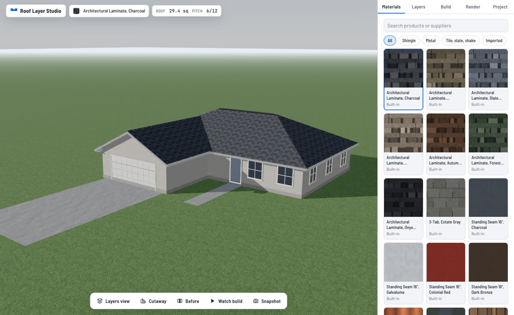 |
| Layers view: 9 layers floating apart with callouts | 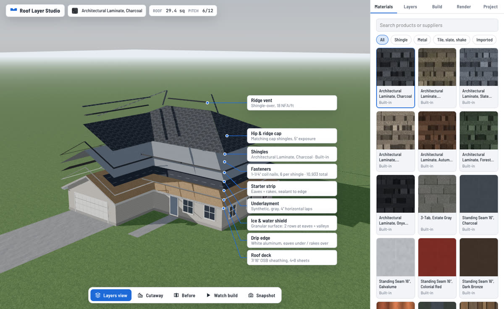 |
| World-space stepped cutaway | 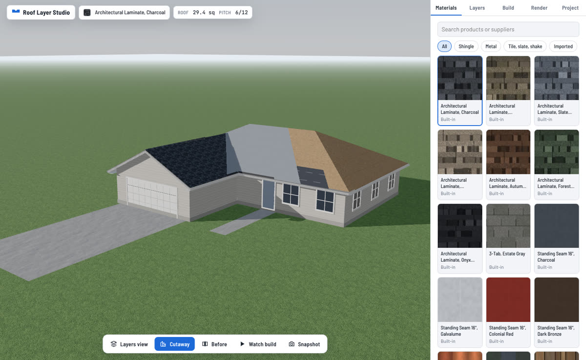 |
| Build playback mid-way: underlayment on, shingles course by course from the eaves | 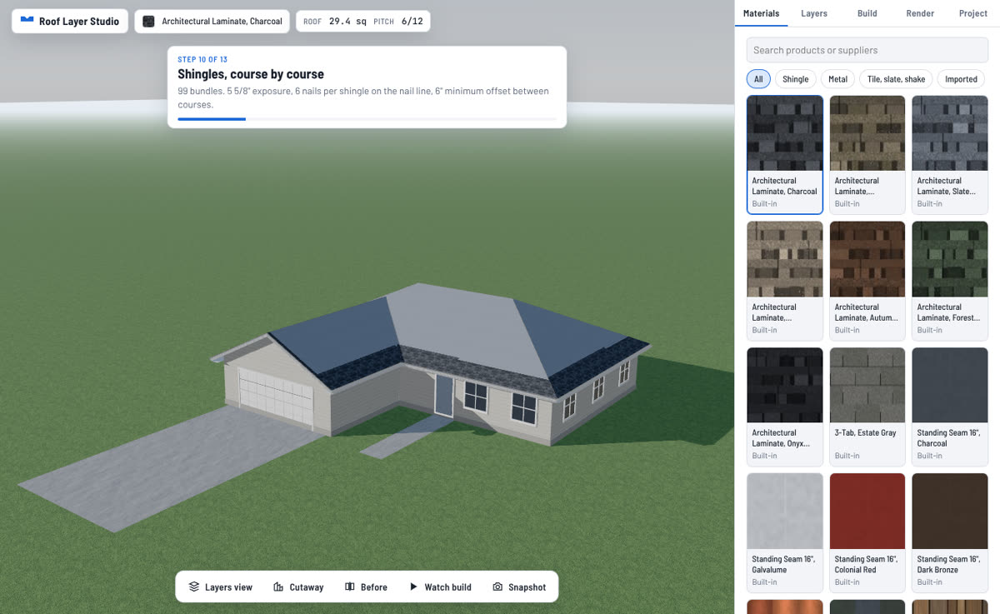 |
| Phone width, dark theme, metal roof, tear-off caption | 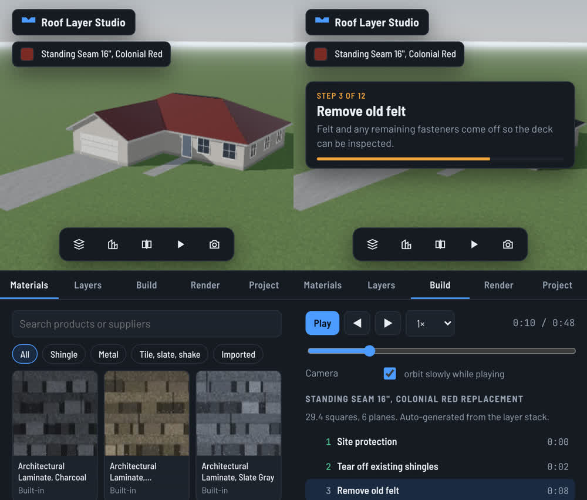 |
| Path tracing, 24 samples | 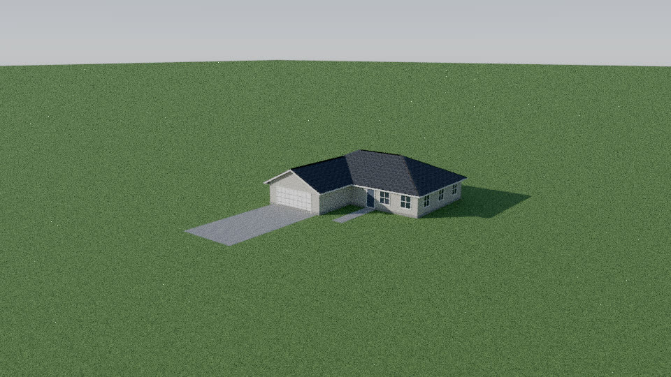 |
| 4K tiled snapshot with burned-in labels (downscaled here) | 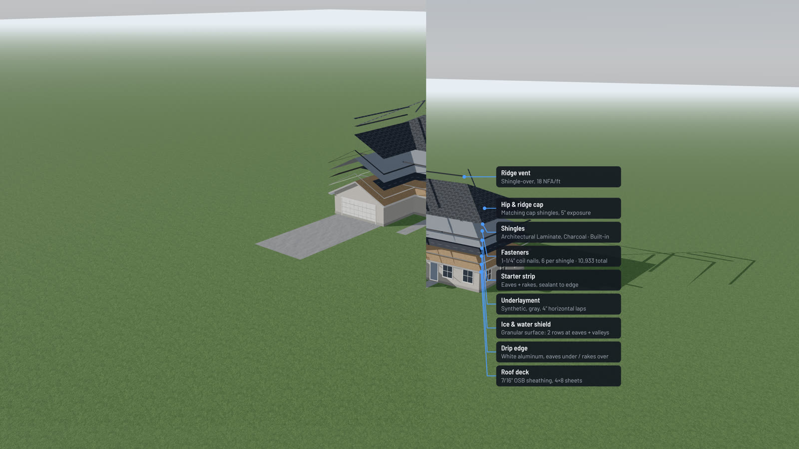 |
| Blender Cycles: finished, tear-off, mid-build, exploded with labels | 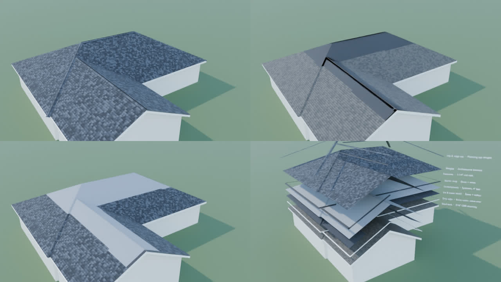 |
| Blender build video, frames across the timeline | 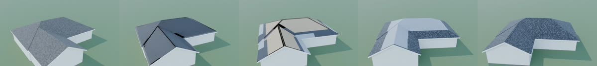 |
| Blender house to GLB, then the web viewer finds the roof and rebuilds every layer | 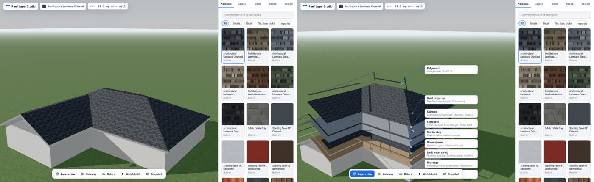 |

### Numbers (CPU only, so treat timings as worst case)

| Measure | Value |
|---|---|
| Web app ready (procedural textures included) | 3.8-5.6 s |
| Roof layer triangles without nails | about 4,000 |
| Nails | 10,933 nails at 21 triangles each (they were 72 each before optimizing; 787k triangles at first) |
| 4K tiled snapshot, exploded, with labels | 6.7-16 s |
| Path-traced snapshot 960×540, 24 samples | 93 s (expect seconds on a GPU) |
| Blender: demo house + 12 layers | about 1 s |
| Blender still 640×360, 12 samples | 3.4 s |
| Blender build video 480×270, 160 frames, 4 samples | 2 min 43 s |
| Demo roof (Blender, 0.40 m overhang) | 28.96 squares; eaves 66.0 m, rakes 8.94 m, ridges 15.4 m, hips 32.4 m, valleys 12.0 m. **Wrong, corrected in 010:** 27.43 squares, eaves 58.3, ridges 15.45, hips 32.70, valleys 12.15 m at 0.45 m overhang |
| Demo roof (web, 0.45 m overhang) | 29.4 squares. **Wrong, corrected in 010:** 27.4 |
| GLB exported from Blender | 16 MB, mostly nail geometry |
| Tests | 8/8 Node tests, all Blender core checks |

### Gaps found

- Blender's procedural shingle shader reads like a brick pattern up close (experiment 004).
- No flashing, chimneys, pipe boots, skylights, or gutters as a layer (005).
- The GLB is heavy because of nails (006).
- Not run yet: a real GPU, the blender-mcp addon inside Blender's UI, Windows, a real RoofTec model, Claude-written plans (needs an API key), supplier images with recorded rights.
- Supplier-site "product images" can be rendered spheres or whole-house photos, which do not map onto a roof. The importer now asks for straight-on swatch photos.

### Finding from the first lab capture

At a 1000 px window with the side panel open (628 px of 3D view), the layers-view labels move to the left over the house, the model is framed small, and the bottom label is hidden by the toolbar. Desktop widths and phones were fine. Tracked as backlog 009.

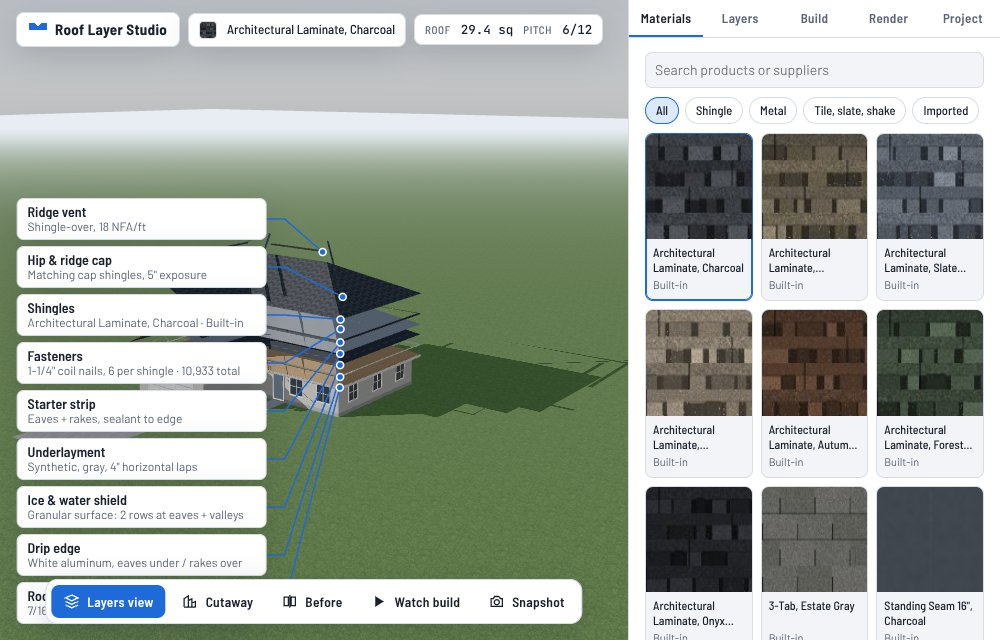

## Decision

Keep both tools as the lab starting point. Run experiment 001 on the user's PC next to get real GPU numbers.
