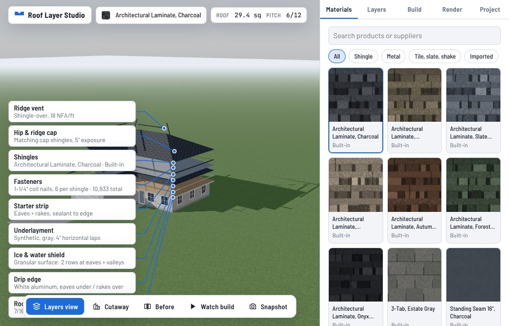
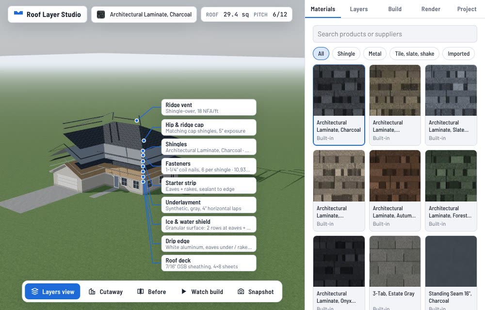

# 009 · Layers-view labels on narrow screens

| | |
|---|---|
| Track | T5 |
| Session | cloud |
| Date | 2026-11-15 |
| Status | done |

## Question

Why do the layers-view labels cover the house and hide behind the toolbar when the 3D view is medium or narrow, and how should they behave instead?

## Method

1. Reproduced at a 1000×640 window (628 px of 3D view) with `lab/tools/capture.mjs --shots layers`.
2. Found three causes in `roof-visualizer/viewer/js/labels.js` and `frameView()` in `app.js`:
   - The label column only fit beside the model on wide views; otherwise it fell back on top of the house.
   - The layout ignored the top bar and the toolbar, so the bottom label slid under the toolbar.
   - The camera framing reserved no room for labels when the view was narrower than it was tall.
3. Changes:
   - `labelMetrics(width)` picks one of three label sizes: full (250 px, title and spec), mid (196 px, smaller type) and compact (134 px, title only, under 520 px wide).
   - The layout keeps labels between the top bar and the toolbar, squeezes the spacing when many layers are shown, and stacks the column at the right edge.
   - `frameView()` reserves that right-hand strip, fits the model into the rest and moves the model up a little because the toolbar is taller than the top bar.
4. Captured the layers view at 1000×640, 1400×860, 1920×1080 and 390×844, plus a 1080p snapshot to check labels are still burned in.

## Result

| Window | Before | After |
|---|---|---|
| 1000×640 (laptop with panel) | labels over the house, bottom label under the toolbar | labels beside the model, all visible ([image](img/after-medium-1000px.jpg)) |
| 1400×860 | fine | unchanged, labels right of the model ([image](img/after-wide-1400px.jpg)) |
| 1920×1080 | fine | unchanged ([image](img/after-large-1920px.jpg)) |
| 390×844 (phone) | labels fit, house tiny | title-only labels, larger house ([image](img/phone-before-after.jpg), before left) |
| 1080p snapshot | labels burned in | still burned in ([image](img/after-snapshot-1080.jpg)) |

Before, 1000×640:

After, 1000×640:

Unit tests: 8/8 pass. Not checked: real phones and tablets (the phone shot is a 390×844 desktop window), and the layout while the window is resized during the layers view (framing only updates when the view is toggled).

## Decision

Keep. The same fix is applied to the open pull request (#1), so it is already in the code headed for `main`, and the published demo artifact is updated.
