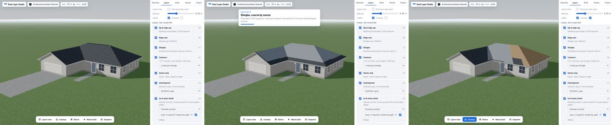
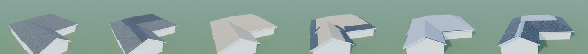
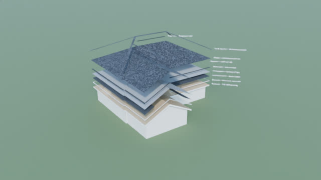

# 010 · Independent review by Claude Fable 5.2

| | |
|---|---|
| Track | all |
| Session | cloud |
| Date | 2026-11-15 |
| Status | done (deferred items in the backlog) |

## Question

What would a second, independent reviewer find wrong with the web app, the Blender pipeline, the lab setup and the docs, and how much of it can we fix now?

## Method

Two reviewers ran on Claude Fable 5.2 in parallel, each with the code and the user's goals but none of our conclusions:
- **Web app and server:** 21 findings.
- **Blender pipeline, lab and docs:** 25 findings.

Both ran code to verify findings and changed no files. Each finding was then checked again here before fixing. One claim was tested from first principles: the sun direction was calibrated against a marker in a rendered sky panorama.

## Result

### Fixed and verified

| Area | Problem found | Fix | Evidence |
|---|---|---|---|
| Measurements | Shared edges double-counted and the roof under the garage counted: 29.4 sq instead of 27.4, ridge 24.9 m instead of 15.45, hips 49 m instead of 32.7 | Dedupe edges by distance; notch the main plane under the garage (web and Blender) | `tests/geometry.test.mjs` and `test_roof_core.py` match hand calculations for 3 houses on Blender 5.2.4 and 4.2.0 |
| Real houses | A one-mesh house lost its walls on import (web), and every mesh was hidden in Blender's slope fallback | Remove only the roof triangles (web); hide nothing in the fallback (Blender) | Code path; fallback logs a hint |
| Path tracing | Snapshots came out blank | Draw before yielding the frame, no fade | 23,290 of 24,000 pixels drawn without `preserveDrawingBuffer` (was 0) |
| Local server | Any website could post to it; IPv6-mapped addresses beat the SSRF guard; remote SVG served same-origin; no DNS pinning | Host, Origin, Sec-Fetch-Site and JSON checks; BlockList with mapped and NAT64 unwrapping; connect-time lookup guard; raster-only proxy with nosniff and a sandbox CSP | `tests/server.test.mjs`, `tests/supplier.test.mjs`, live curl checks |
| Phones | GPU textures leaked on every change; the page rendered every frame while idle | Dispose materials and maps; render on demand; Standard quality on touch devices | Code |
| Roofing accuracy | Ice & water rows fixed at 2, "24 inches inside the wall" claimed without math, 6 nails default, 5" caps, deck repair always "3 sheets", bundle wording on tile and metal | Auto rows from overhang and pitch, 4 nails standard (6 high wind), 5-5/8" caps, deck allowance input, category-aware wording, suggested waste 10/15/17/20% | Screenshot below: 2 rows (47" up the slope), 97 bundles at 17% |
| Build sequence | Valley ice & water popped in at the end; caps on hips and ridge at once; plan numbers unchecked (NaN) | Valley sheets as the last row; hips then ridge; plan validation with step numbers; Claude plan files capped at 20 | `tests/build.test.mjs` |
| Supplier photos | Dropped photos were saved without a rights check; photo courses did not match geometry | Session-only drop; save via the dialog with rights; exposure and "3D courses" controls | Code |
| Blender renders | Black bands in build videos (8 transparent bounces); lamp mirrored against the sky; camera cropped exploded stacks; frame-step videos broken; failures exited 0 | 64 bounces; lamp at π − azimuth (calibrated); vertical-FOV fit including the exploded height and labels; concat encode at fps/step; `--python-exit-code 1` and a required `RT_RESULT` | Images below; `test_roof_core.py` sun and bounce checks |
| Blender details | Old roof covered the exploded deck; `material` after `build` lost the animation; GPU setup enabled the CPU; Blender 5 PNG/media type; orphaned meshes | All fixed; render results now report seconds, device, Blender version | Exploded image below |
| Lab and docs | blender-mcp is now "MCP for Blender" (`uvx mcp-for-blender install-addon`); experiment 001 could not be completed as written; doctor scored a missing Blender as neutral; README video section wrong for roofing; license gaps | Docs updated (checked against the upstream README); 001 rewritten as a step-by-step runbook; doctor marks missing tools and checks uv and the Blender version; `.gitattributes` and `node_modules` ignore; license guide corrected | This folder, `lab/NEXT.md`, `README.md` |

### Deferred (now in the backlog)

- Offline use: vendor three.js, the path tracer and the fonts instead of loading them from CDNs (011).
- Robust roof-plane detection for noisy scans (region growing or RANSAC) and T-junction meshes (012).
- Photo crop and perspective correction for supplier photos (013).
- Starter, cap and underlayment fasteners in the nail count; valley metal and flashing lines in the takeoff (005).
- Reveal-aware geometry for path tracing mid-build. For now the tracer pauses.

## Decision

Keep every fix. Ask the reviewers again after experiment 001 and 003 run on real hardware and a real house.
