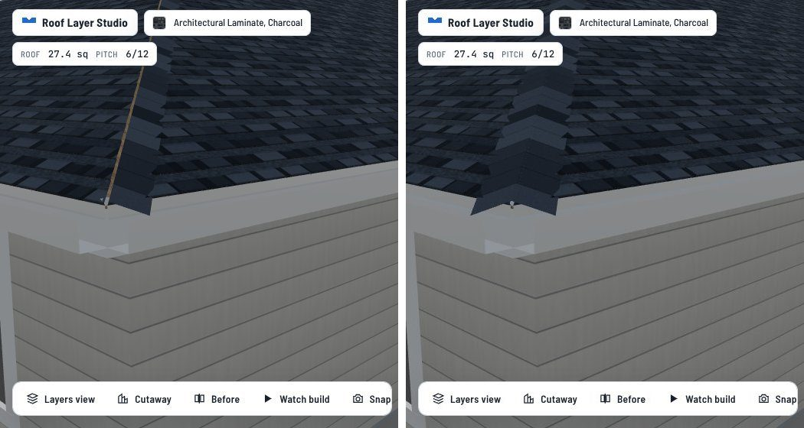
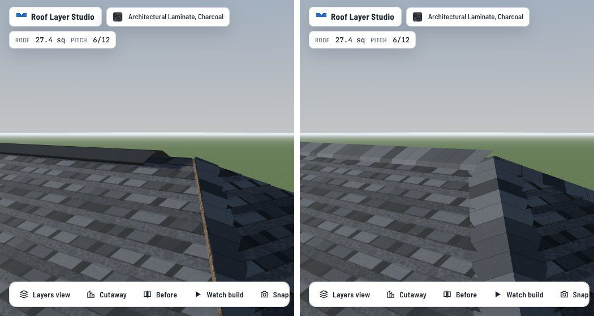
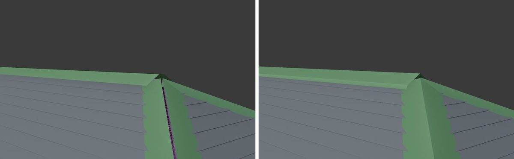
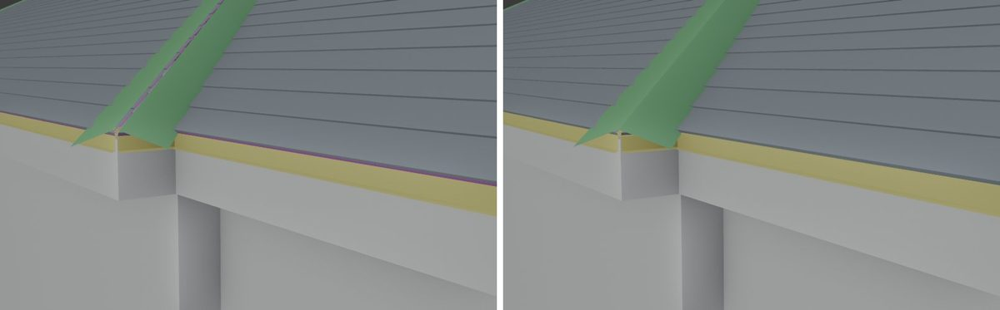

# 014 · blender-master QA on the roof layers

| | |
|---|---|
| Track | T2 (accuracy), T3 (layers) |
| Session | cloud |
| Date | 2026-11-16 |
| Status | done |

## Question

Does an independent geometry checker find real defects in the roof layer stack? We used the checker from the MIT-licensed **blender-master** skill. If it does, can its checks become a repeatable gate for both apps?

## Method

1. Loaded the `/anthropic-skills:blender-master` skill and ran its `env_report.py`: Blender 5.2.4 LTS (pip `bpy`), Cycles and EEVEE, no GPU.
2. Built the ranch demo with `roof_core.py` (`ensure` + `scene`) and saved it.
3. Ran `qa_check.py --profile render` on every `RT_layer_*` object, then `review_shots.py`.
   - `review_shots.py` needs `apt-get install -y libegl1 libegl-mesa0` in the cloud.
4. Rendered Workbench close-ups of a hip and an eave, before and after the fixes.
5. Wrote a winding check for the web geometry (Node).
6. Took web viewer close-ups with the new `lab/tools/closeup.mjs`, comparing the old code (a git worktree of `f2552dc`) with the new code.

## Result

**qa_check on the old code: 9 errors and about 30 warnings.**

| Finding | Real? | Fix |
|---|---|---|
| Half of every hip and ridge cap, and of the ridge vent, faced down into the roof | **yes, visible in the web app:** caps use one-sided materials, so one half of each hip cap did not render (images below) | Blender: `Buf.tri(face=...)` winds each polygon toward a given direction. Web: `makeGeometry` winds every triangle to match its normal |
| Drip edge: 2 of its 3 faces were inside-out | yes: wrong lighting in the web app, wrong side in Blender | same, plus the kick's normal now points out and up |
| Old shingles still in the finished still | **yes, visible:** a purple line along the eave under the new shingles | `build_layers` hides the old roof; `animate_build` brings it back for the tear-off |
| Slit along every hip and ridge between the two cap halves | yes: about 3 cm wide, showing the deck edge | both halves share one crest point, the same height above each plane |
| Ridge vent floated about 30 mm above the shingles with nothing under its edges; the cap floated above the vent | yes (Blender; web had sides but a gap) | vent sides stand on the shingles; the cap drapes over the vent onto the shingles (same profile in both apps) |
| Repair sheets 0.6 mm above the deck | yes in WebGL depth precision | lifted to 1.2 mm |
| Valley ice & water lapped the eave rows in the same plane; rake starter lapped eave starter | yes, flicker during the build | valley strips start where the eave rows end; rake starter starts above the eave starter (`vmin`) |
| Drip edge drop shared the deck's edge face at the rakes | yes | the bend sits 1.5 mm out, in the roof plane |
| Starter 1.0 mm above the rake drip flange | borderline | starter moved from 16.8 to 17.2 mm |
| Old layers coplanar with new ones | no: never on screen together | checks skip the old roof |
| UV overlap, duplicate verts, roof not at z = 0 | no: tiled world-space UVs, flat-shaded strips, roof only | ignored as noise |

**qa_check on the new code: 1 error, accepted.** Two valley membranes lap where the valleys meet at the garage apex (2 triangle pairs, about 0.012 m² each). That is how they are installed, and the underlayment covers it.

Speed: `lab/tools/roof_qa.py` runs in 6.6 s on the cloud CPU and checks 10 layers (131k triangles). It passes on the new code and fails on the old code with 4 errors.

Tests:
- Node: 13/13, including a new check that every triangle faces its normal. It fails on the old code with 4 of 8 ridge-cap triangles wrong.
- Blender: all `test_roof_core.py` checks pass, including 3 new ones. The new checks fail on the old code with ridge-cap normal z of -0.87.

Images, old code on the left and new on the right:

| | |
|---|---|
|  | Web hip foot: the near half of the hip cap was missing |
|  | Web ridge end: missing hip half and dark ridge cap, fixed |
|  | Blender (Workbench, colored by layer): old shingles (purple) seen through the cap slit, closed now |
|  | Blender eave: old shingles (purple line) under the new roof, gone now |

## Decision

- **Keep** all fixes. They are in both apps (web `roof-geometry.js` and `layers.js`; Blender `roof_core.py`).
- **Keep** `lab/tools/roof_qa.py` as the geometry gate. Run it after any change to `roof_core.py` or the shared layer heights.
  - It uses the four scripts vendored in `lab/tools/vendor/blender-master/` (MIT), so sessions without the skill get the same checks.
- **Promote** the geometry fixes with the next app pull request (already on PR #1's branch).
- **Next, local:** run `roof_qa.py` with real Blender on a real RoofTec house (`--blend`), and look at a Cycles close-up of a hip in Blender's viewport.
