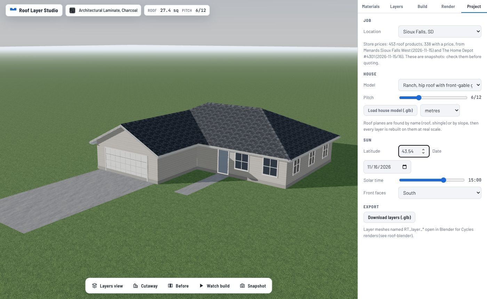

# 015 · Sioux Falls supplier intake

| | |
|---|---|
| Track | T1 (supplier materials), project `lab/projects/sioux-falls-studio/` |
| Session | cloud |
| Date | 2026-11-16 |
| Status | done |

## Question

Can both Sioux Falls store captures become one catalog the studio can use, with each product tied to a roof layer, its sold unit and its coverage?

## Method

1. Menards #3064 package (Nov 15, 2026), committed without images to `lab/data/suppliers/menards-3064-2026-11-15/`:
   - products, variations, material library, 3D asset manifest, specs and documents;
   - its `HANDOFF.md`.
2. Home Depot #4301 `materials.json` (Nov 15–16), read from PR #3's branch `claude/stoic-keller-boixwx`, commit `3c1fa29`.
3. `roof-visualizer/scripts/lib/supplier-catalog.mjs` turns each source into the studio's layers:
   - **Menards:** layer from its "3D asset class" column.
   - **Home Depot:** layer from category, subcategory and the product name.
   - **Coverage:** taken from the spec text, or from the name ("33.33 sq. ft. per Bundle", "25 lin. ft.", "36 in. x 66 ft.").
   - **Piece lengths:** taken from the name for edges and vents.
   - **Prices:** a missing price stays null, never 0.
4. Build the catalog:
   ```
   node roof-visualizer/scripts/build-supplier-catalog.mjs --menards lab/data/suppliers/menards-3064-2026-11-15 --homedepot <materials.json>
   ```
   It writes `roof-visualizer/viewer/catalog/suppliers/sioux-falls.json` (350 KB).
5. Tests: `roof-visualizer/tests/suppliers.test.mjs`.

## Result

**453 roof products, 338 with a price.** (Corrected in 016: 337 priced; one Menards price was a 9,999,999.99 placeholder.)

| Layer | Menards (priced) | Home Depot (priced) |
|---|---|---|
| covering: shingle, metal, cedar | 28 (28) | 179 (129) |
| ridge cap | 10 (10) | 35 (10) |
| starter | 4 (4) | 22 (4) |
| underlayment | 12 (12) | 26 (23) |
| ice & water | 6 (6) | 20 (18); 4 of them are narrow flashing tape |
| drip edge and rake | 14 (14) | 35 (22) |
| ridge vent | 6 (6) | 19 (18) |
| valley | 9 (9) | 28 (25) |

**Corrections found while checking samples:**
- Home Depot files narrow flashing tapes and a chimney coating under underlayments. The tapes are now tagged `flashingTape` and the coating is excluded.
- A gutter mesh was filed under metal panels, and a "roofing combo" kit under shingles. Both are excluded.
- Bundle coverage is not always 32.8 sq ft. GAF Grand Sequoia covers 20 sq ft per bundle, 5 bundles a square. The quantity rule uses each product's stated coverage: 30 squares of Owens Corning Duration is 92 bundles, not 90.
- Menards lists some shingles "each" instead of per bundle. A shingle with bundle-sized coverage is treated as one bundle.

**Tests:** 18/18 web tests, 5 of them new.

**Studio:**
- The Project tab has a Job section: Sioux Falls, SD (43.54 N) is the default location for the sun.
- A line shows the store prices loaded: "453 roof products, 338 with a price ... snapshots: check them before quoting".
- `roofStudio.suppliers()` returns the catalog.

Not done: colors. Swatch hex values need your OK to download the swatches (plan, open question 1).

## Decision

**Keep.** Next is step 016, the product picker, after your answer on swatches. Re-run the build script whenever a store capture is refreshed.


