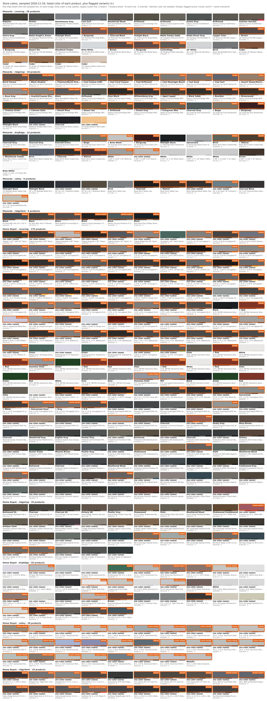
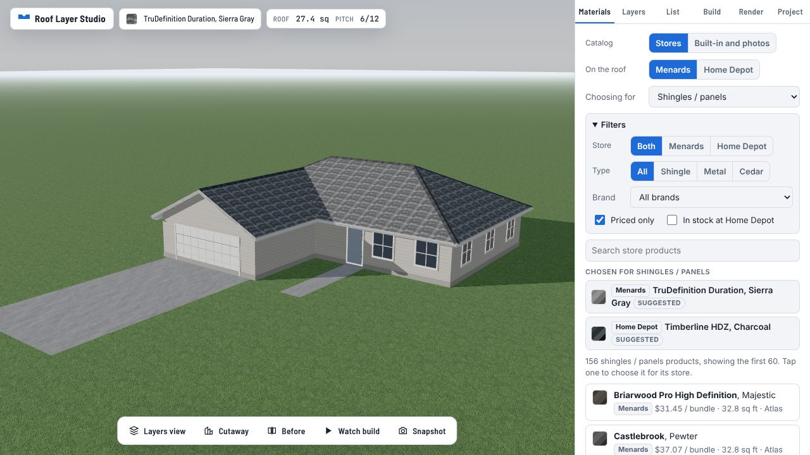
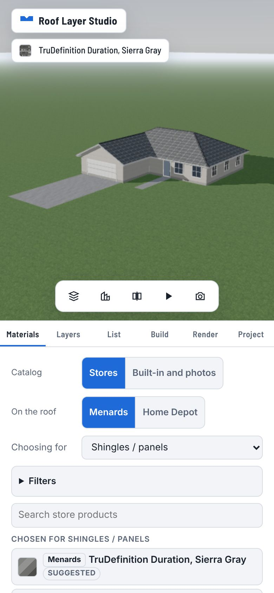
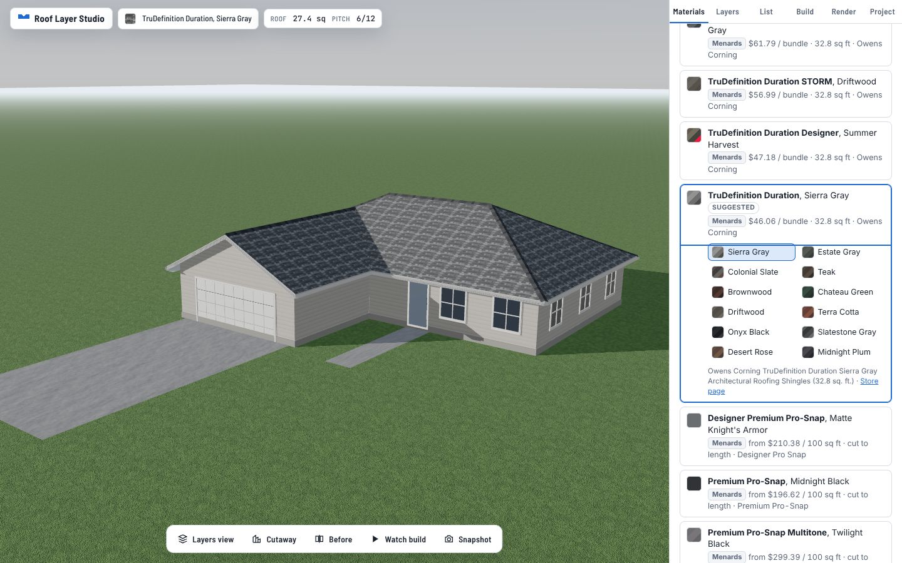
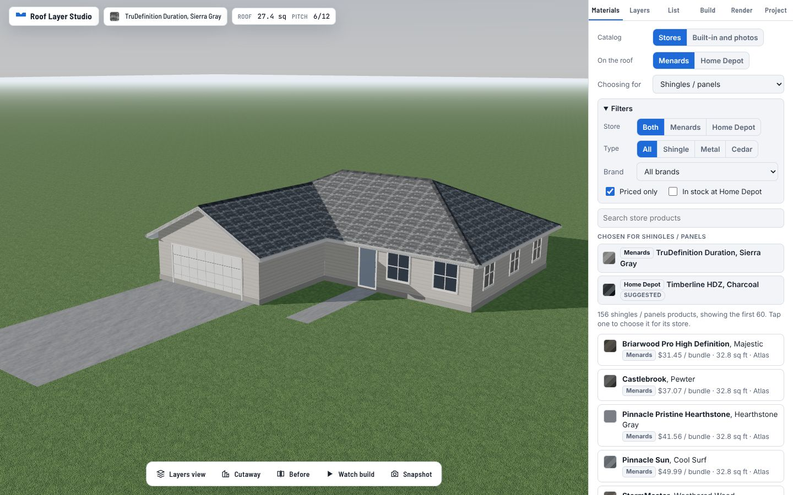
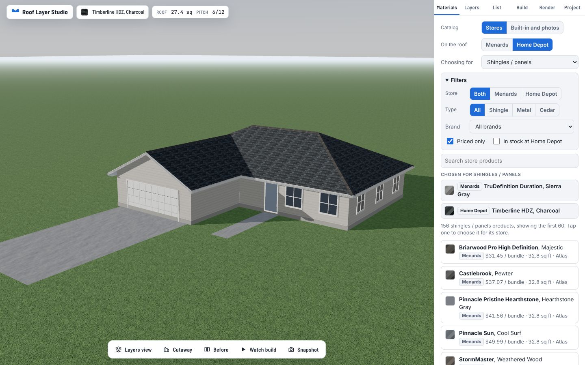

# 016 · Store picker and colors

| | |
|---|---|
| Track | T1 (supplier materials), project `lab/projects/sioux-falls-studio/` |
| Session | cloud |
| Date | 2026-11-16 |
| Status | done (colors, then the picker) |

## Question

1. **Colors (done):** can every store product the roof draws get its real color, sampled from the store's own swatch or product photo, without storing a single store image?
2. **Picker:** can a user pick any store product for any roof layer, from either store, and see it on the roof in that color, with no store image loaded? See "Picker" at the end.

## Method

### Catalog version 2 (follow-up to 015)

`roof-visualizer/scripts/lib/supplier-catalog.mjs`, tests in `roof-visualizer/tests/suppliers.test.mjs`:

- **Placeholder prices:** a price of 50,000 or more is dropped. Menards VB Defender (`mn-1642874365673314`) listed 9,999,999.99. **Corrected: 337 priced, not 338.**
- **Pack counts:** `packCount` = pieces in one sold package, read from the name ("(4-Pack)", "10PCS", "Carton of 10", "10-Piece"), accepted from 2 to 100. Found on 104 products. On shingles and caps it counts the shingles in a bundle, so use it only for products sold by piece length.
- **Bundles per square:** "(3 BD/SQ)" is read as 33.3 sq ft per bundle (38 IKO and Atlas shingles at Home Depot).
- **Metal panels (Home Depot):** coverage = W × L × pack count, marked `basis: 'gross'` (side laps not deducted). 82 of 114 Home Depot metal coverings now have a coverage; a length alone ("12 ft. Corrugated …") stays unknown.
- **Menards metal ridge caps:** no square-foot coverage.
- **PBR starting values:** `pbr: { metallic, roughness, type }`.
  - Menards: per color, from `material_library.csv`.
  - Home Depot: by rule. Painted metal 0.3 / 0.45; bare galvanized or galvalume 0.9 / 0.35 when the name gives no paint color; asphalt 0 / 0.9.
- `version: 2`; key order kept; one-line JSON.

### Colors

**Which images (530 unique URLs):**

| | Menards | Home Depot |
|---|---|---|
| Swatch links (variants) | 123 | 66 (35 px chips) |
| Product photos (listed color) | 54 | 287 (fetched at 300 px) |

- Only the layers drawn on the roof are sampled: covering, ridge cap, drip edge, valley and ridge vent (363 products, 663 color entries).
- **Listed color:** the product's `color`, else the entry with the product's own item id (4 Roser parts list colors but none as shown), else its only entry. A product that lists no color gets an entry with `name: null` for its photo (248 products).

**Download** (`roof-visualizer/scripts/sample-supplier-colors.mjs`, approved by the user):
- user-agent `roof-lab-color-sampler/1.0 (internal color reference)`, no cookies, no referer;
- one request at a time, at least 1 s between requests to the same host (the two hosts take turns);
- 403 or 429 stops that host for the run; a 5xx or 20 s timeout is retried once after 5 s;
- 4 MB cap;
- the bytes go straight from memory to `ffmpeg` (96 × 96 RGB), and no image file is written.

**Statistic** (`roof-visualizer/scripts/lib/swatch-color.mjs`, tests in `roof-visualizer/tests/colors.test.mjs`), as in plan 5.4:
1. Remove the near-white background connected to the border.
2. Drop light neutrals (luma above 165 for asphalt, 205 otherwise; skipped for white products). Flag `scene` when more than 15% goes.
3. Trim 5% at each end by luma.
4. k-means palette (k = 4, deterministic).
5. Hex = linear-light mean. For metal, trim and vents, when two clusters differ by more than 60 on a channel, take the largest cluster and flag `mixed`. The plain mean is kept in the cache as `mean`.
6. Name check (`name-mismatch`; it never changes the hex).

**Merge:** `build-supplier-catalog.mjs` reads the cache and `scripts/data/supplier-color-overrides.json`, so a rebuild never downloads. The order is:
1. override;
2. sampled swatch or photo;
3. name rule (`colorFromName`).

Commands:

```bash
node roof-visualizer/scripts/sample-supplier-colors.mjs                    # fetch what the cache lacks
node roof-visualizer/scripts/sample-supplier-colors.mjs --recheck mixed    # fetch only entries with that check again
node roof-visualizer/scripts/build-supplier-catalog.mjs --menards lab/data/suppliers/menards-3064-2026-11-15 --homedepot out/hd.json
node roof-visualizer/scripts/sample-supplier-colors.mjs --sheet lab/experiments/016-store-picker-colors/img/chips.jpg
```

## Result

**Catalog v2:**
- 453 products, 337 priced.
- Home Depot source hash still `06040ac740d39e77`.
- Two builds in a row give the same file.
- The file is 486 KB (66 KB gzipped).

**Downloads:**

| | Count |
|---|---|
| Images linked | 530 |
| Sampled | 529 |
| Failed | 1: `too large`, the Menards Hearthstone Gray photo (over 4 MB) |
| Refused (403/429) | 0 |
| Cached (skipped on later runs) | all 530 |
| Requests in all | 698 |

- **First run:** 4 trial requests, then 526 in 7.4 min.
- **Recheck:** the 168 `mixed` images were fetched again in 3 min, to record their plain mean. The hexes came out the same. One image is no longer `mixed`, likely because the server returned slightly different bytes.

**Coverage:** 363 of 363 listed colors have a hex (100%; the goal was 95%).

| Source | Listed colors | All 663 entries |
|---|---|---|
| swatch | 14 | 314 |
| product photo | 348 | 348 |
| name rule | 1 (the image over 4 MB) | 1 |
| override | 0 | 0 |

**Check against the planner's Python prototype** (plan 5.4, tolerance 14 per channel): **16 of 16 within tolerance**, largest difference 11 (Roser valley Walnut, 13% of the photo kept).
- Two of my first reference picks were different images of the same color name: the Timberline Shakewood chip, and a cedar cap instead of the 24 in. shake bundle.
- Matched to the right images, they agree within 1 and 3.

**Flags:**

| | Listed colors (363) | All entries (663) |
|---|---|---|
| `scene` | 47 | 71 |
| `mixed` | 153 | 171 |
| `name-mismatch` | 16 | 27 |
| any flag | 178 | 227 |

- **Shingles:** 16 of 117 listed shingle colors (13.7%) carry `scene` or `name-mismatch`. That is above the plan's 10% line, so: the shingle colors from scene photos (Atlas gable pictures, IKO house shots) need a look by eye, not more tuning here.
  - Four Menards cap lines link a gable-scene photo for every color: Atlas Pro-Cut and StormMaster, Owens Corning Impact Ridge and ProEdge. All 26 of their entries are `scene`.
- **`mixed` is common and is not a review signal by itself.** It fires on 153 listed colors, mostly Home Depot photos of panel stacks, vents and trim where shading alone puts clusters more than 60 apart.
  - The largest cluster is the better color. Of the 58 `mixed` entries whose name has a color rule, the name check passes 49 times with the largest cluster and 29 times with the plain mean (30 to 25 for spreads of 60–100).
  - So the threshold stays at 60.
- **Thresholds:** final values 165 (asphalt light neutrals) and 60 (mixed spread), both unchanged. 165 matched the Burnt Sienna scene within 4; no systematic shingle miss is visible on the sheet.

**Name mismatches for you to judge** (27; none overridden, `supplier-color-overrides.json` is still `{}`):

| Product | Color | Hex | From | Flags |
|---|---|---|---|---|
| `mn-1444424429039` Atlas Pro-Cut hip & ridge | Black Shadow | `#535554` | swatch (gable scene) | scene |
| `mn-6698461259175797` Atlas StormMaster hip & ridge | Black | `#5a5c5d` | photo | scene |
| `mn-1642874295566164` Steel corner & gable trim | Beige | `#75766c` | swatch (gray part) | |
| `mn-1642874257826205` Roser side flashing | Walnut | `#4b3436` | swatch | mixed |
| `mn-1444448570651` Residential ridge cap | Beige | `#75756b` | swatch (gray part, as the plan expected) | |
| `mn-1444448570651` Residential ridge cap | Burgundy | `#371e20` | swatch (dark red, R leads by 23 < 25) | |
| `mn-4283774896157214` Pro-Snap | Burgundy | `#6c5a5c` | swatch | |
| `mn-4283774896157214` Pro-Snap | Charcoal Black | `#5d5d60` | swatch | |
| `mn-1444448678420` Pro-Snap Multitone | Twilight Black | `#6f6e70` | photo | |
| `mn-1444448595958` Pro-Rib Copper | Brown | `#534948` | swatch | |
| `mn-1444448595958` Pro-Rib Copper | Burgundy | `#5c4c4e` | swatch | |
| `mn-1444448546780` Pro-Rib Brite White | Brown | `#534948` | swatch | |
| `mn-1444448546780` Pro-Rib Brite White | Burgundy | `#5c4c4e` | swatch | |
| `mn-4363828714382548` VentSure 4' ridge vent | Black | `#4a595b` | photo | mixed |
| `mn-1444448677732` White gutter apron | White | `#9d9f9e` | photo (white on white: only shadows are left) | |
| `hd-305625188` Amerimax F5M drip edge, Black | – | `#8d7a75` | photo | mixed |
| `hd-309824048` F8 Brown aluminum roof edge | – | `#c6c7c3` | photo | scene |
| `hd-202092926` Royal Brown drip edge | – | `#3d3032` | photo | scene, mixed |
| `hd-317431767` Terra Bronze/Black valley roll | – | `#807c74` | photo | mixed |
| `hd-340301680` TimberCrest Midnight Mesa cap | – | `#9e5964` | photo | scene |
| `hd-311703886` IKO Cambridge Riviera Red | – | `#7a6e60` | photo | |
| `hd-311704101` IKO Cambridge Super White | – | `#9ea8a7` | photo | |
| `hd-308306135` Shinglevent II, Black | – | `#7d7e7e` | photo | |
| `hd-332048599` NFA 12 ridge vent, Black | – | `#61656d` | photo | mixed |
| `hd-332048560` NFA 18 ridge vent, Black | – | `#61656d` | photo | mixed |
| `hd-100027903` Cobra SnowCountry, Black | – | `#565859` | photo | mixed |
| `hd-205665304` VentSure strip vent, Black | – | `#746a67` | photo | scene, mixed |

- Black plastic vents photograph as dark gray (luma 86–126). Ridge vents are not drawn in their store color, so this does not show on the roof.
- Two Home Depot galvanized valley rolls (`hd-341809126`, `hd-341809127`) come out blue-gray (`#a6b2d1`, `#878eb2`). Their plain mean is just as blue, so the photos themselves are tinted.

**Chip sheet:** our own flat chips drawn from the sampled hex, no store image. 1600 × 1707 px, 469 KB. Orange tags: S scene, M mixed, N name mismatch.



**Data gaps found on the way** (for step 023; counts not changed here):
- `hd-335627062` "GAF QuickMeasure Reports" (a measuring service) and `hd-340153814` "Timberline HDZ Shingle Sample Collection" are filed as coverings.
- `hd-342806428`, a "WeatherWatch Barrier, FeltBuster Underlayment, Pro-Start … Timberline" bundle, is filed as a ridge cap; kits like it are excluded elsewhere.
- Menards variant links for steel colors (Pro-Rib, Pro-Snap, trim) are often photos of another part or a building. Their Burgundy and Brown chips read gray-brown.

## Decision

**Keep the colors.**
- The catalog carries `hex`, `palette` (up to 4, largest cluster first), `colorSource` and `colorCheck` on each color entry. The product carries the listed color's `hex`, `palette`, `colorSource` and its `pbr`.
- Re-run the sampler after a store re-capture: it fetches only new URLs.

**Needs local:** compare the sampled colors by eye with the store pages, for the 10 best-selling shingles and the 27 name mismatches above. Write corrections to `roof-visualizer/scripts/data/supplier-color-overrides.json` as `"<product id>|<color name>": { "hex", "note" }` (use `"<id>|"` for an entry with no color name), then rebuild.

---

## Picker

### Method

- **Recipes** (`roof-visualizer/viewer/js/supplier-products.js`, plan section 7):
  - `toStudioProduct()` turns a store covering into a studio product: shingle, shake or metal recipe, sampled palette, exposure and profile sizes, and `approx` notes for what is assumed.
  - `layerOptionFor()` gives what a ridge cap, drip edge, underlayment or ice & water product changes on its layer.
- **Store picker** (`roof-visualizer/viewer/js/supplier-ui.js`, `viewer/css/suppliers.css`), at the top of the Materials tab:
  - **Catalog:** Stores, or Built-in and photos (the earlier grid, importer and upload, unchanged).
  - **On the roof:** Menards or Home Depot. The roof draws that store's chosen products: the covering, the cap palette or metal cap color, the drip edge color, and the underlayment and ice & water type. The exploded-view labels and the Layers tab name each product, as in "ProEdge, Williamsburg Gray · Menards".
  - **Choosing for:** the 8 slots, from Shingles / panels to Valley.
  - **Filters** (one "Filters" disclosure, closed on phones): store, type (coverings only), brand, "Priced only" (on) and "In stock at Home Depot". Plus a search box.
  - **"Chosen for …":** both stores' current choices, with a "suggested" tag until the user picks. A tap scrolls to that row.
  - **Rows:**
    - a CSS color chip of the sampled palette, hatched when there is no hex;
    - line 1: short name and color;
    - line 2: store, price with unit ("from $116.84 / 100 sq ft", "no price: ask the store"), coverage, brand and Home Depot stock.
    - When two rows share a short name, a third line gives the store's full name. This happens with 67 Home Depot metal panels.
    - At most 60 rows show, then "Show 60 more".
  - **A tap on a row** chooses it for its own store. The roof updates when that store is on the roof; otherwise a toast says how to see it.
  - **Under the chosen row:** its colors as named chips, any `approx` note, the full name and a "Store page" link.
  - Flashing tape, closures and undercourse are left out.
- A new job starts with the plan's suggested basket. **The studio now opens with the shown store's covering on the roof:** Menards Duration, Sierra Gray. `?product=<built-in id>` still opens a built-in product.

### Result

| Check | Result |
|---|---|
| Any slot, either store | all 8 slots list their products; picking a Home Depot product while Menards is shown leaves the roof alone, and switching to Home Depot draws it |
| No store image requests | 0 requests to `cdn.menardc.com` or `images.thdstatic.com`, 0 `img` elements, after every slot, the list and the dialog |
| Duration and Timberline in their sampled colors | below; Duration Sierra Gray `#7c7d7b` (palette `#818280 #929391 #6e6f6d #4c4d4b`), Timberline HDZ Charcoal `#383c3d` |
| Layout | no horizontal scroll or clipped text at 1440, 1280 and 390 |
| Console | 0 errors |

| 1440 | 1280 | 390 |
|---|---|---|
|  |  |  |

The chosen row lists its colors as named chips, and a tap changes the color on the roof:



| Menards Duration, Sierra Gray | Home Depot Timberline HDZ, Charcoal |
|---|---|
|  |  |

The Pro-Rib close-up (`img/prorib-close-1440.jpg`) and its measured rib spacing are in experiment 019.

### Decision

**Keep.**
- The picker draws everything from the catalog's hex and palette, so it works offline and in an artifact. It never requests a store image.
- The default roof is now a store product. Older screenshot commands that relied on the first built-in product need `?product=arch-charcoal`.
- **Needs local:**
  - check the picker on a real phone (touch, bottom sheet);
  - judge Duration and Timberline against their store pages on a real GPU.
