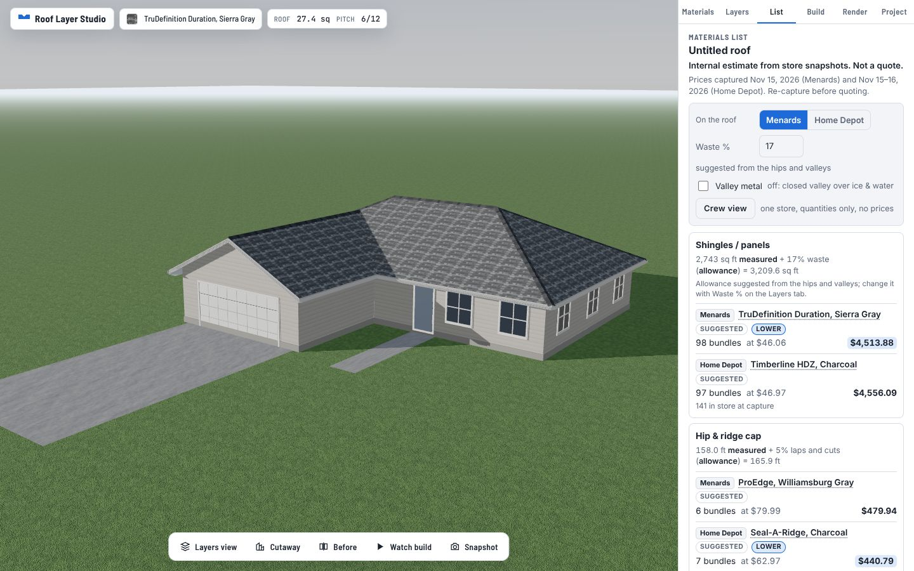
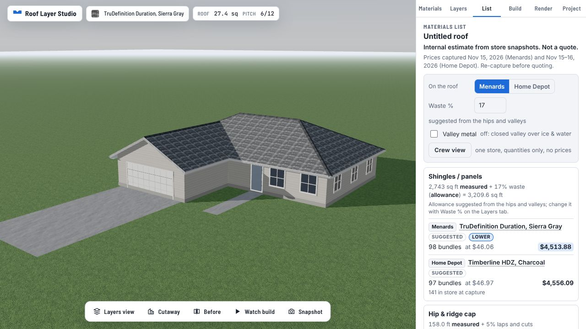
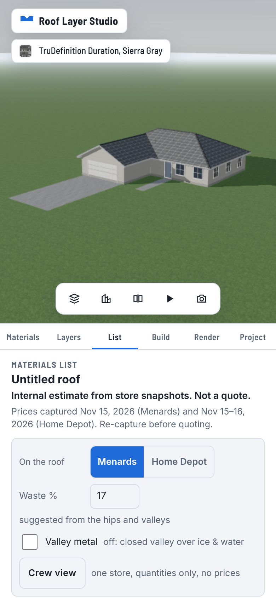
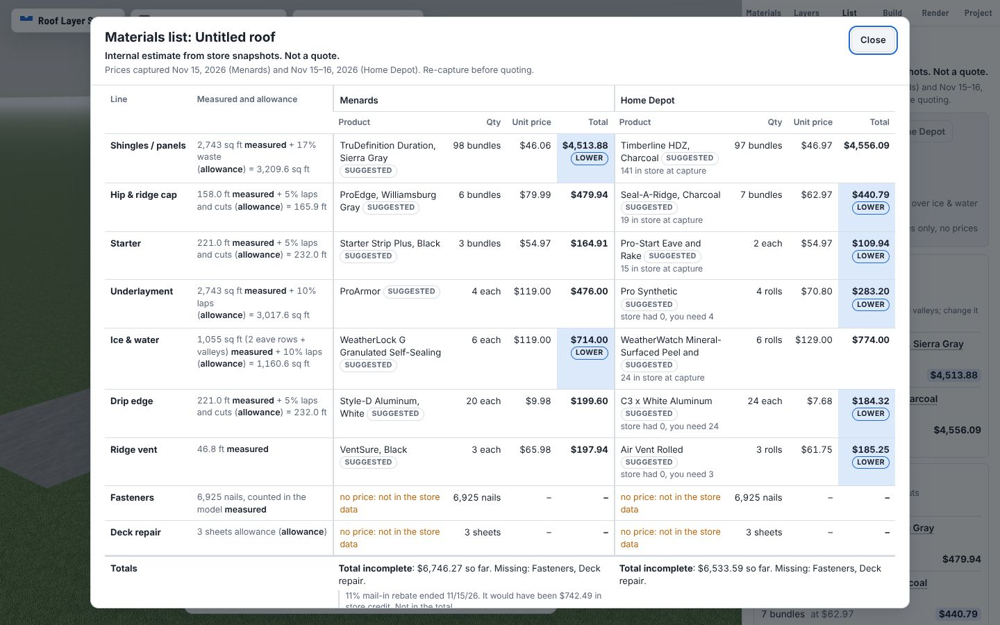
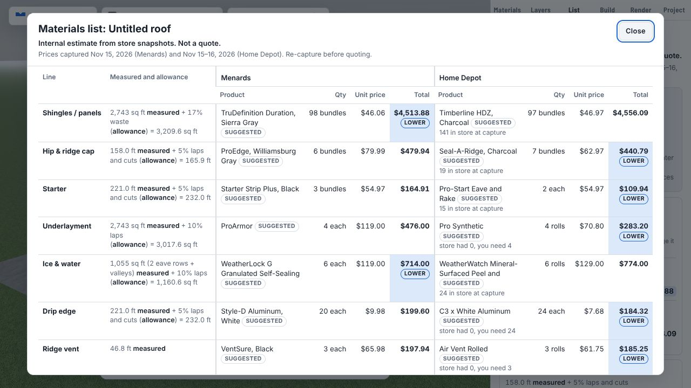
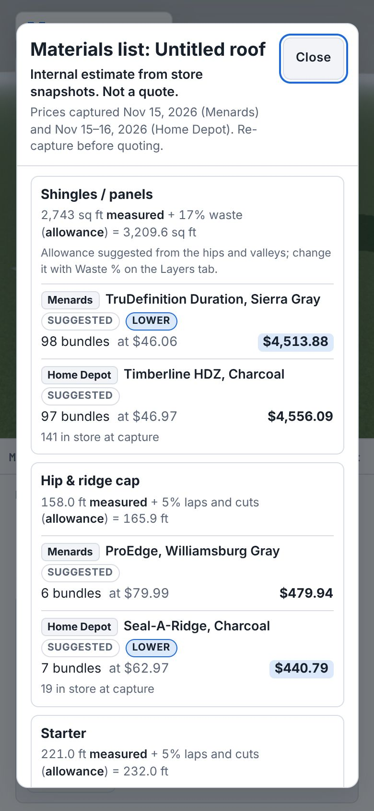
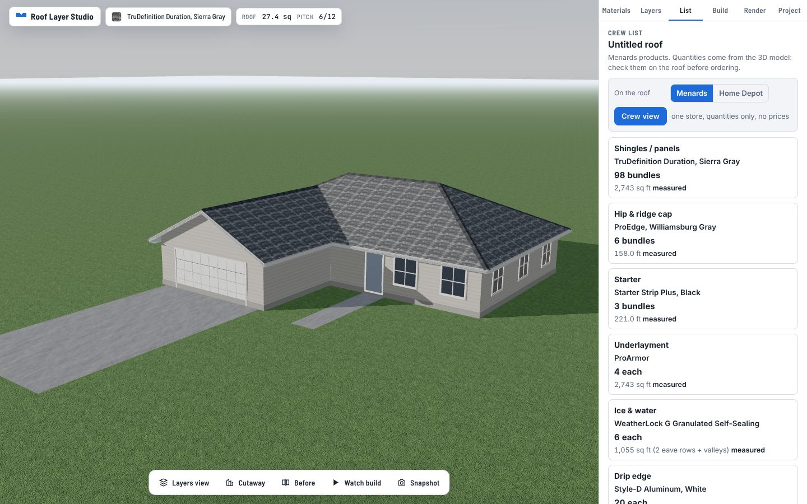
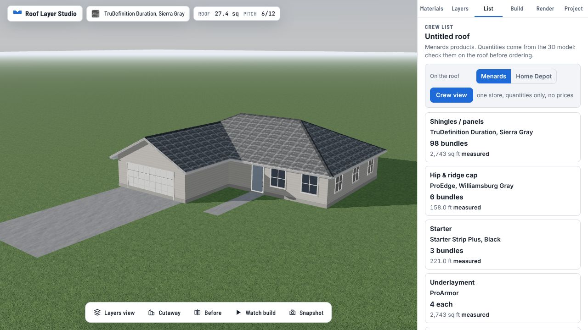
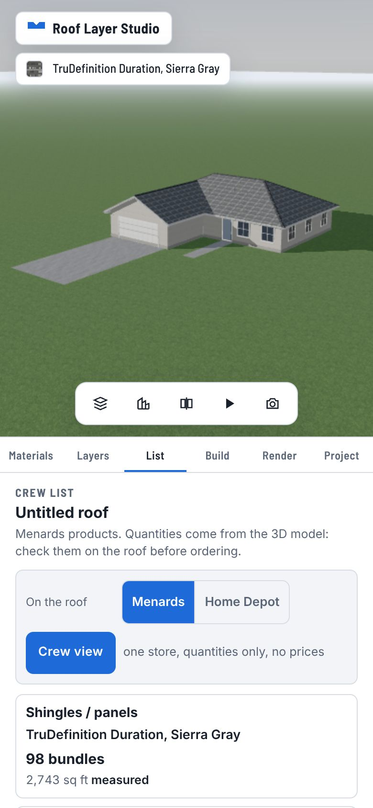

# 017 · Priced materials list

| | |
|---|---|
| Track | T1/T6, project `lab/projects/sioux-falls-studio/` |
| Session | cloud |
| Date | 2026-11-16 |
| Status | done |

## Question

Can the measured roof become a materials list priced at both Sioux Falls stores? Each line needs the store's own unit (bundles from coverage, rolls, pieces, cartons). The list must never print a zero for something unknown, the crew view must carry no prices, and the list must download as CSV.

## Method

- **Rules** (`roof-visualizer/viewer/js/quote.js`, plan section 6):
  - `buildQuote({ q, job, catalog, today, priceOverride })` builds the lines, both store cells per line, the "lower" tag, three totals with their status, the Menards rebate block and the age banner.
  - `crewView()` builds the crew list and `quoteCSV()` the CSV files.
  - Tests are in `tests/quote.test.mjs`; every figure of plan 6.7 is asserted there.
- **Measured inputs:** `RoofLayers.quantities()` in `layers.js` wraps `toQuantities()`. It returns feet and square feet:
  - area, squares, eaves, rakes, ridges, hips, valleys;
  - the ice & water mesh area with its rows;
  - ridge vent length: each ridge of 0.9 m or more, less 0.3 m at each end;
  - nail count, the deck-repair allowance and the roof product's category.
- **Takeoff:** `takeoff()` now shows measurements only. It ends with a link "Order quantities and prices: List tab", so the app never shows two bundle counts.
- **UI** (`roof-visualizer/viewer/js/supplier-ui.js`, `viewer/css/suppliers.css`, a new **List** tab):
  - header with the job name, "Not a quote." and the capture dates;
  - "On the roof" store switch, Waste % (mirrors the Layers tab), Valley metal, Crew view;
  - one card per line with both store cells;
  - totals, rebate, and what is not included;
  - buttons: Open full list (a side-by-side table dialog), Download CSV, Download crew CSV, Copy as text.
- **Checks:** `lab/tools/supplier-shots.mjs --checks` against `node scripts/serve.mjs` (software WebGL), screenshots at 1440 × 900, 1280 × 720 and 390 × 844 (phone, touch).

## Result

**Ranch demo in the page** (`roofStudio.quote()` on the default job, waste 17% suggested):

| | Menards | Home Depot | Lowest per line |
|---|---|---|---|
| Priced lines | $6,746.27 | $6,533.59 | $6,431.38 |
| Status | incomplete (fasteners, deck repair) | incomplete | incomplete |
| With nails $89 and deck $96 typed | complete, $6,931.27 | complete, $6,718.59 | |
| Rebate block | "11% mail-in rebate ended 11/15/26. It would have been $742.49 in store credit. Not in the total." | | |

- **Two takeoff errors are fixed.** Bundles now come from coverage: 98 at 32.8 sq ft, where the old flat 3 per square gave 97. The ridge vent subtracts its end gap per ridge: 46.75 ft, not 49.
- With Pro-Rib Ash Gray on the roof, the covering reads "32.10 squares, from $3,750.56" and the starter line drops out.
- **Unit fix found while building:** `packCount` on shingles, caps and starters counts shingles per bundle. `quote.js` used to label such a line "pack of 21"; it now stays "bundle". New test: "packCount on a shingle counts shingles per bundle".
- **Unit tests:** `npm test`, 77 passed, 0 failed.

**Section 11 checks** (`supplier-shots.mjs --checks`):

| Check | Result |
|---|---|
| Ranch numbers in the page | pass: the three totals above, all incomplete, rebate $742.49, 98 bundles, vent 46.75 ft |
| No hotlinks | pass: 0 store-image requests and 0 `img` elements after every picker slot, the list and the dialog |
| Crew view has no prices | pass: no `$` in `#quotePane`, the crew CSV or the crew text |
| Console | 0 errors |
| Layout | no horizontal scroll and no clipped text at 1440, 1280 and 390, in every view |

**Screenshots** (software WebGL):

| | 1440 | 1280 | 390 |
|---|---|---|---|
| List |  |  |  |
| Full list |  |  |  |
| Crew view |  |  |  |

- **Desktop and laptop:** the dialog shows both stores side by side. The cheaper total has a soft accent fill and the word "lower". At 1280 × 720 the table scrolls inside the dialog under a sticky header.
- **Phone:** the dialog shows the same cards as the panel, with the two store rows stacked and no table. There is no sideways scrolling.

**Crew view:**
- The page is rebuilt with one store and no price, total, rebate, "lower" tag or capture banner.
- `?view=crew` opens the List tab in crew view and removes the switch. In that mode the picker hides prices and the Project tab has no Save button.
- This is a display mode, not access control. The project file and the office CSV hold prices: hand the crew the crew CSV. The app port needs real access control.

## Decision

**Keep.**
- Port the rules (`quote.js`) unchanged to `SiouxFallsApp` after step 018 holds up.
- Nails and deck sheets are in neither store capture, so those lines stay "no price" until someone types an amount. Step 023 (pricing session) should capture a coil-nail box and an OSB sheet at each store.
- Home Depot "Browse Only" items show "store had 0, you need N" from the capture. A re-capture should record availability by store and not only online stock.
