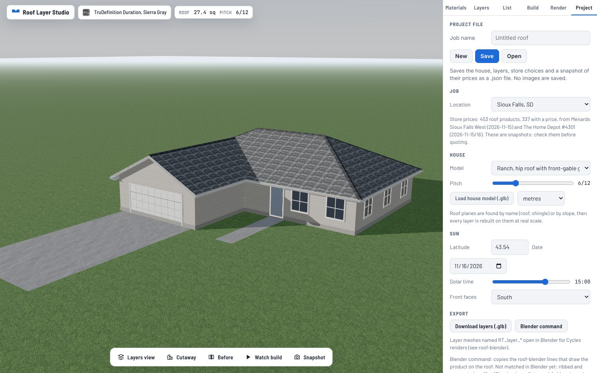

# 018 · Project files

| | |
|---|---|
| Track | T6, project `lab/projects/sioux-falls-studio/` |
| Session | cloud |
| Date | 2026-11-16 |
| Status | done |

## Question

Can a job be saved as one small JSON file and reopened exactly? It has to hold the house, sun, layers, the store product for each layer at each store, waste, typed amounts and a snapshot of the prices. When the store data has changed since the save, the list should say so instead of repricing silently.

## Method

- **Module** (`roof-visualizer/viewer/js/project-file.js`, plan section 8):
  - `buildProject()` writes the project and `parseProject()` validates one.
  - `jobFromProject()` rebuilds the job.
  - `compareSnapshot()` and `snapshotNotice()` find and word price changes.
  - Tests are in `tests/project-file.test.mjs`.
- **Project tab, "Project file"** (`supplier-ui.js`):
  - **Job name** field, and the **New**, **Save** and **Open** buttons.
  - **Save** writes `<job-slug>.rooftec.json` through the studio's `saveFile`.
  - **New** asks first when the job has unsaved changes. It compares the current project with the last one saved, opened or started. Then it resets to the suggested basket on the ranch house at 6/12, Sioux Falls, today.
- **Opening a file** (`app.js` `applyProjectState`):
  - It sets the site, sun, house preset and pitch, and the layer options and custom layers, then rebuilds the house.
  - `supplier-ui.js` then restores the job, the roof product with its fit-to-roof view, the waste source and the hidden layers.
  - When the house was a `.glb` that is not loaded, the studio keeps the current house. It shows "This job used the house model *name*. Load it again on the Project tab.", and the list uses the saved measurements, labelled as such.
- **Price snapshot:** a saved job keeps each chosen product's shelf price, unit, coverage, piece length, pack count and rebate.
  - If the catalog is unchanged on open, the list uses it and shows "Saved Nov 16, 2026".
  - Otherwise the list shows the saved prices and the notice. Each changed cell reads "now $X (+$Y)".
  - **Use current prices** switches to the catalog and lists each total as saved, now, and the difference.
- **Checks:** `lab/tools/supplier-shots.mjs --checks`.
  - Round trip: `a = roofStudio.project()`, then `loadProject(JSON.parse(JSON.stringify(a)))`, then `b = roofStudio.project()`.
  - A hand-edited file: one saved price changed, one saved product id that is no longer in the catalog.

## Result

| Check | Result |
|---|---|
| Unit tests (`project-file.test.mjs`) | pass: round trip, changed price with `was`/`now`, missing product, `version: 2` refused, no `image`/`swatch`/`dataUrl` key anywhere |
| Round trip in the page (after choosing a ridge cap color) | pass: `sameProject(a, b)` is true; totals $6,746.27 / $6,533.59 before and after; the roof is the same store product; 0 image keys |
| Hand-edited file | pass: "Showing prices as saved on Nov 16, 2026. The store data has changed since: 1 price differs, 1 product is gone." Duration cell shows $44.02 and "now $46.06 (+$2.04)"; the gone valley keeps its saved name and price with "no longer in the store capture"; **Use current prices** moves the Menards total from $6,696.35 (saved) to $6,746.27 |
| House model not loaded | the notice shows, the list uses the saved 3,000 sq ft; changing the house preset ends it |
| New with unsaved changes | asks "This job has changes that are not saved." with **Discard and start new** and **Cancel**; after a discard, typed amounts are gone and the totals are the ranch figures again |

**Not saved:** images, the house model file, crew view, camera and render settings.
- A photo on the roof reopens as the built-in default, with "The photo *name* is not saved in project files."
- An unknown store or slot, a non-numeric pitch or waste, or a newer version is refused with one toast naming the first problem.

## Decision

**Keep.**
- The format is version 1. Port `project-file.js` unchanged with the list.
- Not checked here: whether `saveFile` accepts `.json` and `.csv` inside a claude.ai artifact. A normal browser downloads both. The existing toast covers a refusal.
