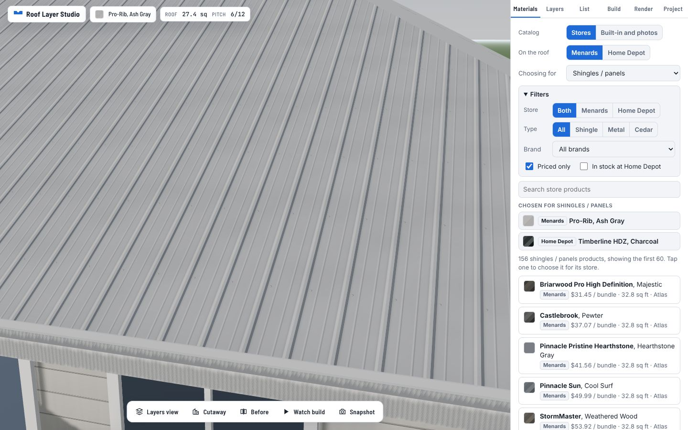
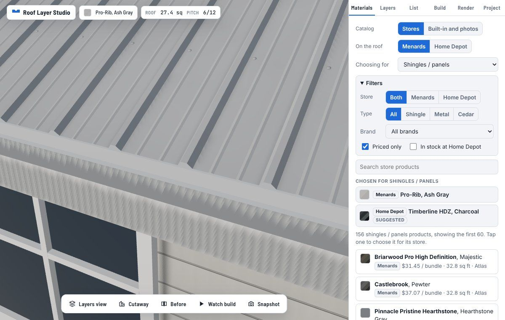
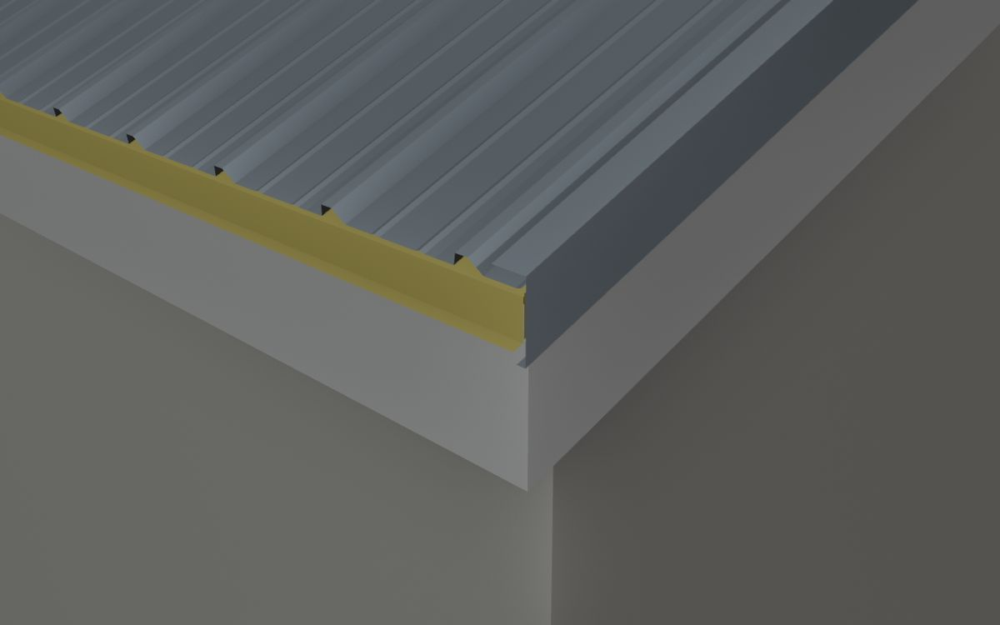
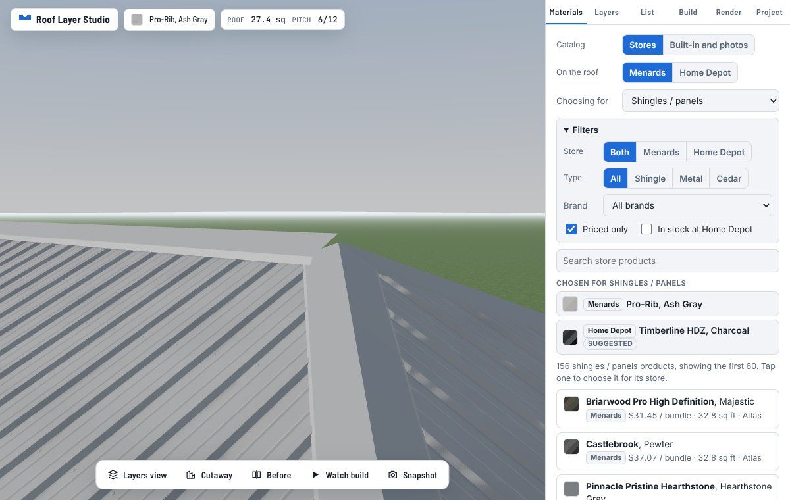
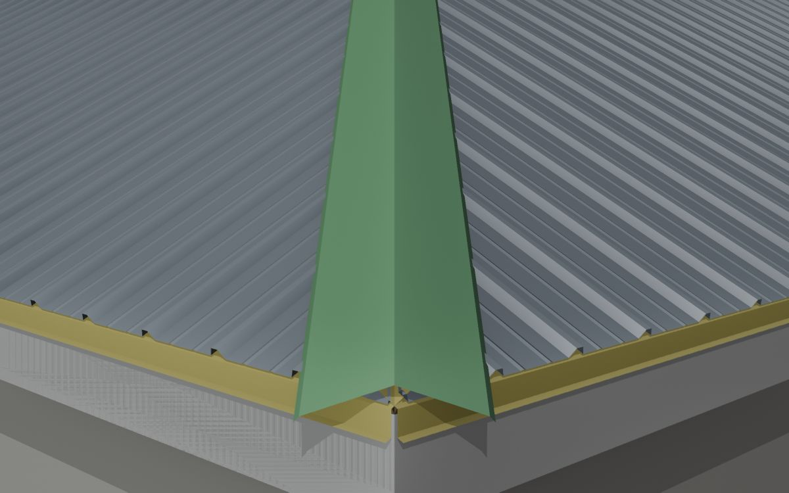
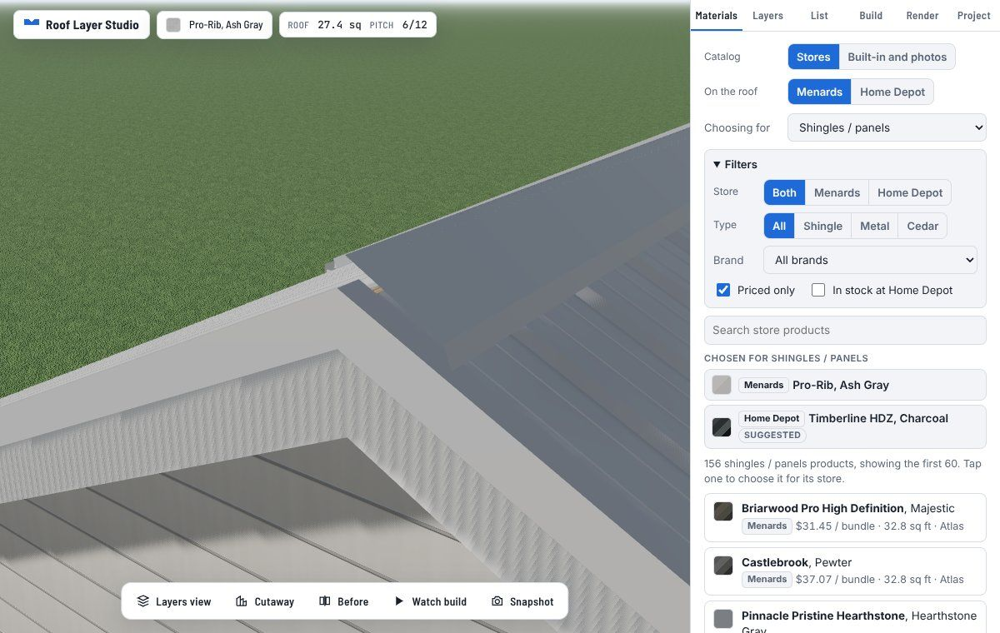
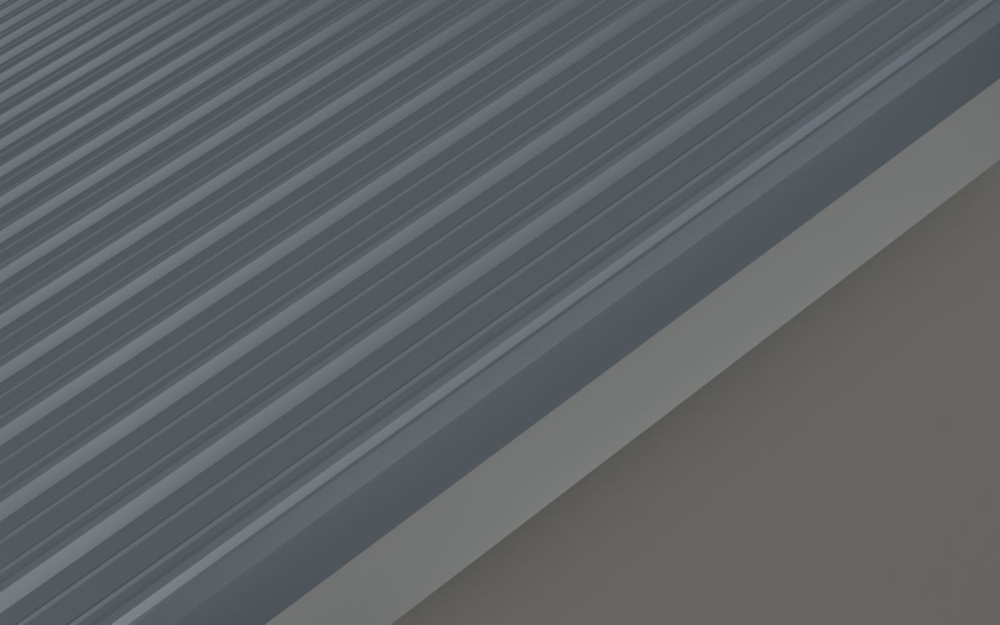
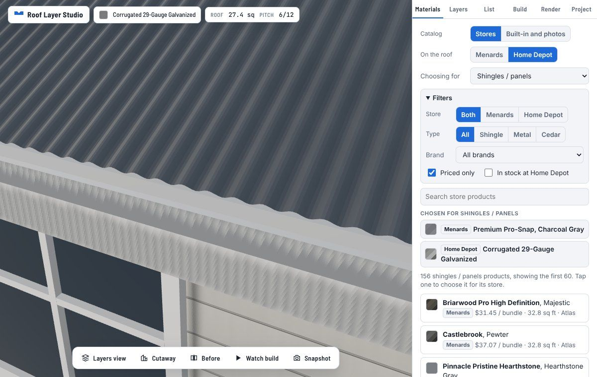
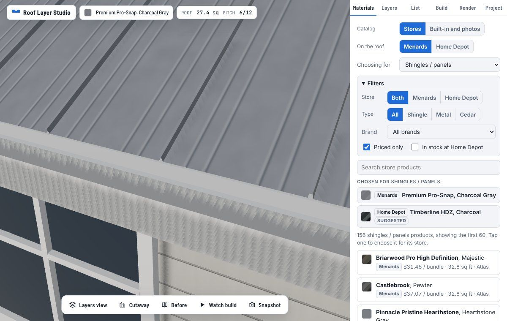

# 019 · Steel panel profiles

| | |
|---|---|
| Track | T2, project `lab/projects/sioux-falls-studio/` |
| Session | cloud |
| Date | 2026-11-16 |
| Status | done: textures, then geometry (cloud); GPU close-up open (local) |

## Question

Can the store's steel panels be drawn at their measured profile in the web studio, so a homeowner can choose between Pro-Rib, Pro-Snap and corrugated on the roof? This step covers textures only. Real rib geometry, the metal ridge cap and rake trim are later (plan section 2), together with step 020 and the `roof_qa.py` gate.

## Method

- **Textures** (`roof-visualizer/viewer/js/textures.js`, appended):
  - **`ribbedPanel`** is an exposed-fastener rib panel. Its tile is one panel cover wide (36 in.).
    - Trapezoid major ribs sit on every multiple of the rib spacing (9 in.): 0.75 in. high, 0.75 in. top, 1.75 in. base.
    - Two low stiffening ribs lie between them (0.12 of the height, 0.6 in. wide).
    - Painted screw heads sit beside each rib at 24 in. on centre.
  - **`corrugatedPanel`** is a sine profile, 2.67 in. pitch and 0.5 in. deep. Its tile is 8 pitches.
  - The height map becomes the normal map, with a strength of pixels per inch / 8. A rib side therefore tilts the light by its real slope.
- **Recipes** (`supplier-products.js`):
  - Menards Pro-Rib becomes `ribbedPanel` with its catalog rib spacing and height (9 in., 0.75 in.).
  - Pro-Snap becomes the existing `standingSeam` at 16 in.
  - Home Depot corrugated becomes `corrugatedPanel`.
  - Home Depot panels with no stated profile become `ribbedPanel`, with the note "profile assumed: the store does not state it".
- **Material:** metalness and roughness come from the catalog `pbr`.
  - Menards painted steel: metallic 0, roughness 0.4, from its material table.
  - Home Depot by rule: painted 0.3 / 0.45, galvanized 0.9 / 0.35.
- **Measured in the page** (`lab/tools/supplier-shots.mjs --checks`):
  - `1 / material.map.repeat.x` of the covering mesh, which is the real width of one texture tile on the roof;
  - the generator's ribs per tile.

## Result

| Product | Tile on the roof | Profile | Spec |
|---|---|---|---|
| Menards Pro-Rib Ash Gray (`mn-1444448546780`) | 0.9144 m = 36.00 in. | 4 ribs per tile = **9.00 in. on centre** | 36 in. cover, 9 in. ribs |
| Home Depot corrugated (`hd-338539708`) | 21.36 in. | 8 × 2.67 in. pitch | common profile (not store data; the card says so) |
| Menards Pro-Snap Midnight Black (`mn-4283774896157214`) | 32.00 in. | 2 panels, a seam every 16.00 in. | 16 in. coverage |

- Pro-Rib Ash Gray renders with metalness 0. Its roughness factor of 1.01 scales the texture's roughness map, whose mean is 0.40, so the average comes out at the catalog's 0.4: painted steel reads satin, not chrome.

**What a texture cannot do** (why the geometry step stays on the list):
- Ribs do not stand up at the eave or rake edge.
- A rib's shadow on the flat does not move with the sun.
- From 3 m the ribs read clearly. At grazing angles they flatten.

## Decision

**Keep the textures** for choosing a product in the studio.
- **019 geometry and 020 edge profiles:** real ribs, the metal ridge cap and rake trim in `roof-geometry.js` and `roof_core.py`. Do them in one session, with the `roof_qa.py` gate and a GPU close-up (local).
- **Blender:** it draws flat panels today. The studio's **Blender command** button says so on its hint.

---

## Geometry part (2026-11-16, cloud)

**Question:** do real ribs, caps on the ribs and a rake trim make the steel roofs read correctly at the eave, rake, ridge and gable peak in both apps, without breaking the geometry gate?

**Method**
- **One shared profile table.** `PROFILES` in `roof-visualizer/viewer/js/profiles.js` and `PANEL_PROFILES` in `roof-blender/scripts/roof_core.py` hold the same JSON. `tests/profiles.test.mjs` fails if they ever differ.
  - Pro-Rib: 9 in. period, 3/4 in. trapezoid ribs and two minor ribs.
  - Pro-Snap: 16 in. period, a 3/4 in. seam.
  - Corrugated: 2.67 in. pitch, 1/2 in. sine.
  - Rib heights and spacings are Menards spec. Rib widths, seam tops and the corrugated profile are assumed, and the table says so.
- **Ribbed surface.** Each roof plane is cut into strips between profile breakpoints, so the height is linear and planar inside a strip. Each vertex is lifted by `h(u)` and gets a normal tilted by the strip's slope.
  - Web: `ribbedSurface()` in `profiles.js`.
  - Blender: `ribbed_surface()`.
- **On the ribs.** On metal roofs, hip and ridge caps use a metal cap profile at `covering + maxH + 3 mm`. Its width is half the cap product's width, or 6 in. by default. The ridge vent, and the vent cap over it, rise by `maxH`.
- **Rake trim.**
  - Shape: a 1.5 in. top leg on the ribs, a face 3.5 in. down and a 0.5 in. hem.
  - Placement: the bend sits 1/8 in. outside the drip edge's kick (16.7 mm with the default edge), so the kick never pokes through. The two trims are mitered at the gable peak.
  - It is drawn in the covering's color.
- **Textures** take `ribs: false` when geometry draws the ribs, so ribs don't appear twice.
- **Blender:** `layers --panel proRib|proSnap|corrugated|flat --cap-width-in N`. The studio's Blender button passes them. Metal caps use the panel's painted steel.

**Result**

| | Pro-Rib | Pro-Snap | Corrugated |
|---|---|---|---|
| Covering triangles, web (ranch demo) | 12,651 | 3,245 | 30,989 |
| Covering triangles, Blender | 12,659 | 3,251 | 30,999 |
| Whole layer stack (Blender gate) | 30,872 | 21,464 | 49,212 |
| `roof_qa.py` | passed | passed | passed |

The shingle stack is 130,874 triangles, so every metal roof is lighter than shingles.

- **Area:** the ribbed surface projected back onto the planes covers 254.856 m², exactly the plane area. There are no gaps, no overlaps and no zero-area triangles.
- **Tests:**
  - Web: 87/87, including 8 new tests, parity among them.
  - Blender: core checks all pass. The default shingle run is byte-identical to before: vertex, polygon and triangle counts and a coordinate checksum match.
- **Gate:** `roof_qa.py --layers '<json>'` passes for shingles, Pro-Rib, Pro-Snap, corrugated and a Style-D edge, with the same single accepted item (the valley membrane lap).

| Web studio (software WebGL) | Blender (Workbench, colored by layer) |
|---|---|
|  |  |
|  |  |
|  |  |
|  |  |

**Decision**

**Keep.**
- Real ribs, caps on the ribs and rake trims are now the default for store steel panels in both apps.
- **Open, local:** a Cycles close-up on the GPU of a Pro-Rib roof at an eave and at the gable peak, made with the studio's Blender button. Judge the rib shading by eye.
- **Later:**
  - the cap hem dips 3 mm below the rib tops, as specified; fine at viewing distance, but revisit if it shows in GPU renders;
  - closures and end caps under the ridge;
  - per-plane panel direction.
