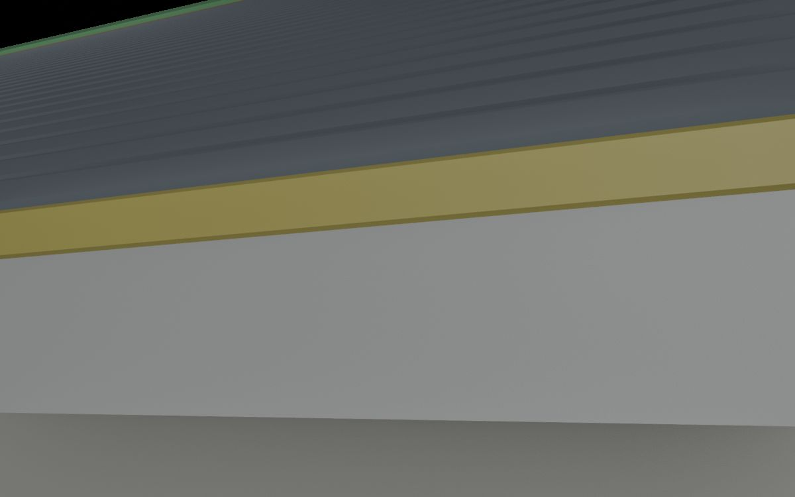
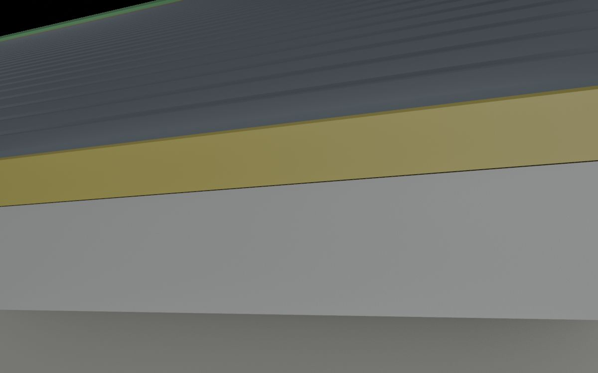
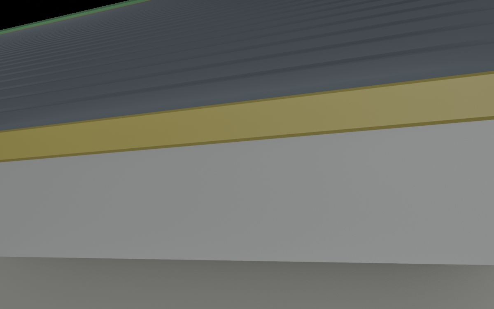
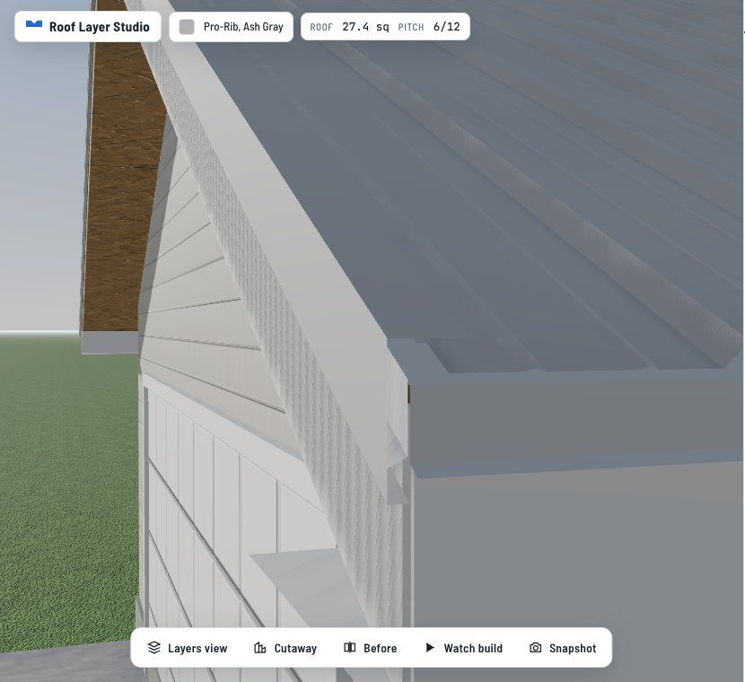

# 020 · Edge profiles from the drip-edge product

| | |
|---|---|
| Track | T2/T3, project `lab/projects/sioux-falls-studio/` |
| Session | cloud |
| Date | 2026-11-16 |
| Status | done (cloud); GPU close-up open (local) |

## Question

Can the drip edge drawn on the roof take its real shape from the product chosen in the store picker, in both apps?

## Method

- **`edgeProfileFor(product)`** in `roof-visualizer/viewer/js/supplier-products.js` returns `{ style, flangeIn, faceIn, kickOutIn, kickDownIn, hemIn, approx }`.
- **Style, from the name or kind:**
  - Style-A;
  - Style-C (C3);
  - Style-D (F-codes count as overhanging D-type);
  - gutter apron;
  - rake trim.
- **Size:** the first two inch dimensions before the length are flange × face (`2-3/8" x 1-11/16" x 12'`, `2.43 in. x 1 in. x 10 ft`). A single dimension is the face, and the flange is then marked assumed.
  - Clamps: flange 0.75–6 in., face 0.5–4 in. A clamp is noted.
  - Kick and hem always come from the style table.
  - With no size in the name, the style defaults are used and marked "size assumed from the profile style".

| style | flange | face | kick out × down | hem |
|---|---|---|---|---|
| A | 1.375 | 1.375 | — | — |
| C | 2.0 | 1.5 | 0.375 × 0.375 | — |
| D | 2.375 | 1.6875 | 0.5 × 0.25 | — |
| apron | 2.5 | 2.0 | — | 0.375 |
| rake | 1.5 | 3.5 | — | 0.5 |

- **Geometry:** `dripEdgeGeometry(segs, { profile })` (web) and `drip_edge_buf(segs, profile)` (Blender) sweep the cross-section along eaves and rakes:
  - flange in the roof plane;
  - bend 1.5 mm outside the deck edge;
  - face straight down;
  - kick;
  - hem.
  - The front side faces out and up. With no profile, today's shape is kept exactly.
- **Wiring:** the studio passes the chosen drip edge's profile to the layer, and the Blender button passes `--edge "flange,face,kickOut,kickDown,hem"`. Blender's cfg key is `edge_profile`.

## Result

- **Names parsed** (tests in `roof-visualizer/tests/profiles.test.mjs`):
  - `2-3/8" x 1-11/16" x 12' Style-D` → D 2.375 × 1.6875.
  - Gutter apron `1-3/4" x 1-3/4"` → apron 1.75 × 1.75.
  - `C3 x 10 ft.` → C, defaults, marked assumed.
  - `2.43 in. x 1 in. x 10 ft. F4 1/2` → D 2.43 × 1.
  - `2.47 in. x 10 ft. Roof Apron` → apron, face 2.47, flange assumed.
  - `3 in. x 12 in. ... Eave Trim` → face clamped to 4 in., noted.
- **Measured in the page and in Blender:**
  - Style-D draws a 1.6875 in. face with its kick.
  - The gutter apron draws a 2 in. face with a hem and no kick.
- **Gate:** `roof_qa.py` passes with the Style-D profile.
- **Rake trim on metal roofs:** it clears the drip edge's kick (019).

| Style-D (Blender) | Gutter apron (Blender) | Today's default (Blender) |
|---|---|---|
|  |  |  |

The web drip-edge close-ups are white on white at this light, so the face heights above were measured in the page, not judged from pictures.

## Decision

**Keep.** The drip edge now follows the chosen product.

- **Open, local:** a GPU close-up of the eave with the Style-D edge and with the gutter apron.
- **Later:**
  - separate eave and rake products: one drip-edge product still serves both edges;
  - pricing for the metal rake trim, which is drawn but has no list line yet.
