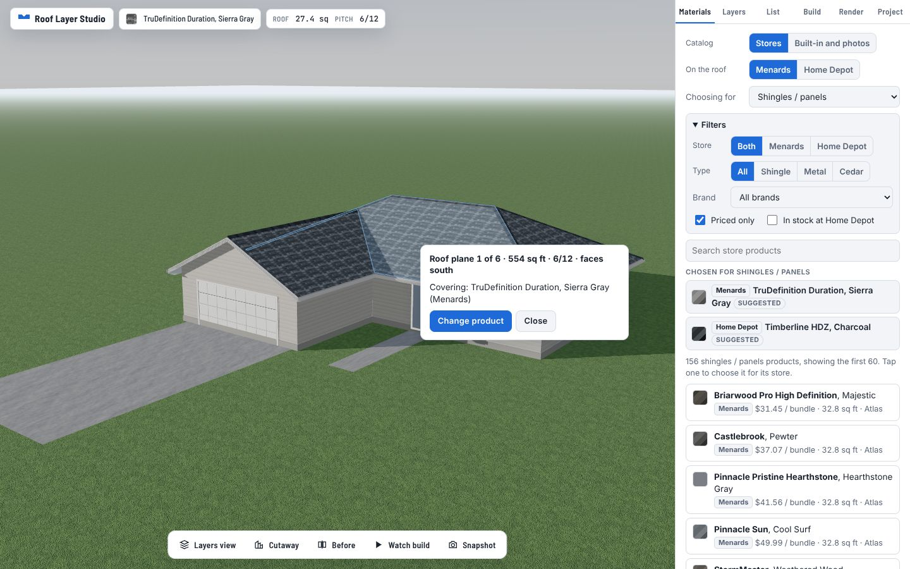
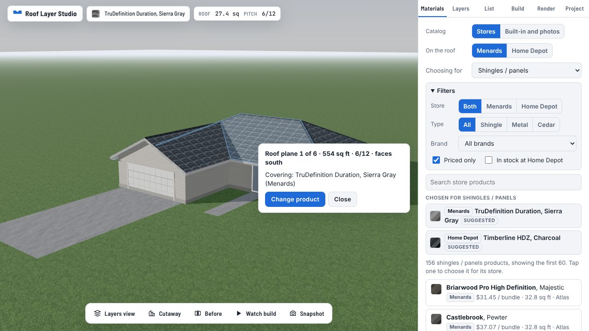
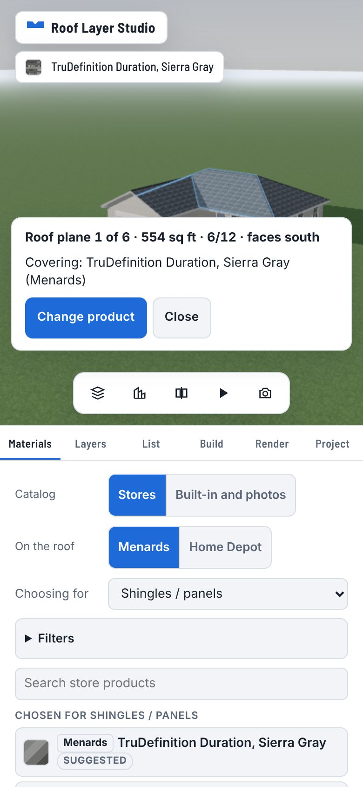

# 022 · Tap the roof

| | |
|---|---|
| Track | T3/T5, project `lab/projects/sioux-falls-studio/` |
| Session | cloud |
| Date | 2026-11-16 |
| Status | done (read-only); changing a product per plane is later |

## Question

Can a tap on the 3D roof show that plane's measured area, pitch and facing, and the product on it, without getting in the way of orbiting? This is the Rooftec Clarity design's "tap the roof".

## Method

- **`roof-visualizer/viewer/js/tap.js`**, wired into `app.js` with a few lines.
- **What counts as a tap:** a press that moved less than 6 px and lasted under 400 ms. The camera controls see every event as before, so a drag still orbits.
- **Finding the plane:**
  1. A ray is cast against the layer stack.
  2. The hit point is moved back by its layer's lift, so it also works in the layers view.
  3. It is matched to the roof plane it lies on: inside the plane's triangles, nearest to the plane, within 25 cm.
- **The card:**
  - Its heading reads "Roof plane *n* of *N* · *area* sq ft · *pitch* · faces *compass*". The facing takes the Project tab's "Front faces" setting into account.
  - It shows "Covering: *product* (*store*)".
  - It has **Change product**, which opens the store picker on the covering slot, and **Close**.
  - It sits next to the tap on wide screens. On phones it is a sheet above the toolbar.
- **Closing:** Escape, a tap on empty ground, or a new layer stack (house or pitch change).
- **Highlight:** the plane's outline 3 to 5 cm above the covering, with a soft 22% fill. The line alone, 1 px wide, was hard to see at house distance.
- **Checks:** `lab/tools/supplier-shots.mjs`, with a mouse click at 1440 and 1280 and a touch tap (`hasTouch`) at 390. A 120 px mouse drag is the orbit check.

## Result

| Check | Result |
|---|---|
| Mouse tap (1440, 1280) | card: "Roof plane 1 of 6 · 554 sq ft · 6/12 · faces south" |
| Touch tap (390, phone emulation) | same card, as a sheet |
| Drag | the camera moved 17.4 m and no card opened |
| Escape | closes the card and removes the outline |
| Console | 0 errors |

| 1440 | 1280 | 390 |
|---|---|---|
|  |  |  |

- On phones the sheet covers the lower part of the house in the 3D view. The tapped plane stays visible above it.

## Decision

**Keep it, read-only.**
- **Per-plane products are later** (plan section 2): the studio has one covering for the whole roof.
- When the app port does per-plane products, the card's **Change product** becomes "change for this plane". A to-scale roof plan as the tap target, Clarity's other idea, can reuse the same plane matching.
