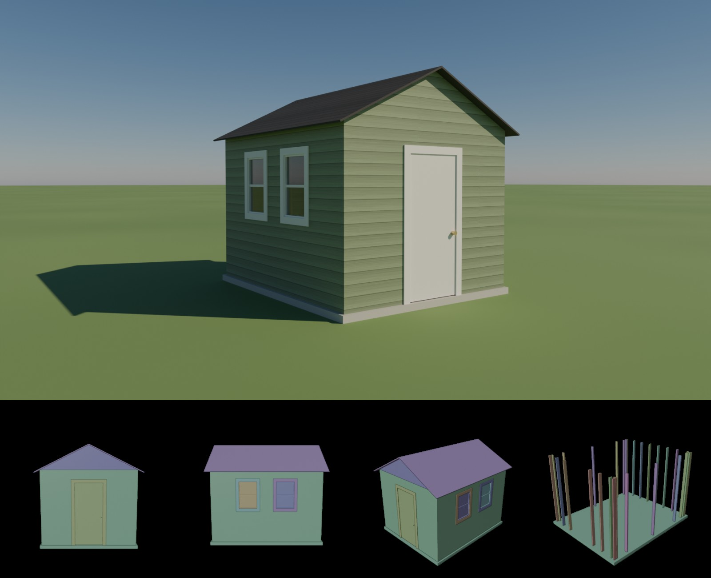

# 024 · Accuracy-first builds (pilot)

| | |
|---|---|
| Track | T7 (build accuracy, then speed; see lab/GOALS.md) |
| Session | cloud (pip bpy 5.2.4, CPU, 4 threads) |
| Date | 2026-11-22 |
| Status | done |

## Question

Does the accuracy-first procedure (acceptance file first, `acceptance_check.py`, `build_log.py`, gates after each stage) hold up on a real build, and does its report show the user every shortcut and assumption?

## Acceptance

Written before the work started. The shed's own checks are `acceptance.json` (23 checks, written from `brief.md` before any geometry). Grouped here:

| What | Target | Tolerance | Source | Checked by |
|---|---|---|---|---|
| Walls: footprint and height | 10 x 12 x 8 ft | 1 mm or 0.1 % | given | `acceptance_check.py` `footprint` |
| Pad | 10.3333 x 12.3333 x 0.3333 ft | 0.1 % | assumed (4 in. slab is standard, 2 in. margin) | `pad` |
| Walls sit on the pad | gap 0 | 0.01 ft, with a why (2 mm overlap) | given | `walls-on-pad` |
| Roof: pitch, ridge, eave, area | 6/12; 10.9265 ft; 8.0833 ft; 1.6096 sq | 0.25 deg; 0.1 %; 0.1 %; 0.5 % | assumed (gap 1), hand-calculated | `pitch`, `ridge`, `eave`, `roof-area` |
| Windows | 4; each 2 x 3 ft; 2 per long side; heads at 7.0417 ft; 60+ tris each | exact count; 1 mm | given; heads standard; detail assumed | `windows`, `window-size`, `windows-left`, `windows-right`, `window-heads`, `window-detail` |
| Door | 3 x 6.6667 ft, centred at x = 5 ft | 1 mm or 0.1 % | standard (gap 2); given | `door`, `door-center` |
| Studs | 28 (hand count: back 9, front 7, sides 6 + 6); 16 in. on center | exact; 1 mm | standard; given | `studs`, `stud-spacing` |
| Materials | sage lap siding (textured), white trim, asphalt shingles (textured), concrete, white door | name patterns | given; door colour assumed | `siding`, `trim`, `shingles`, `pad-material`, `door-material` |
| Hero render | 1920x1080 file, not blank | exact | given | `hero`; render_batch `"deliverable": true` |
| Clean mesh | 0 QA errors, complete | none | standard | `qa_check.py --profile render --max-tris 0` |
| Honest close | `close` says done only without blockers; every shortcut in the report | none | the plan | `build_log.py close`, `report` |

## Method

All from this folder, `PY` = the pip bpy venv, `S` = `.claude/skills/blender-suite/scripts`, `BL` = `$S/build_log.py`.

1. `brief.md`: the request as a user would write it, with two gaps on purpose (roof pitch, door size).
2. `acceptance.json` from the brief, every number with its source. Pitch: assumed (it should be asked; no user in a sub-agent run). Door: standard size looked up, so not a shortcut.
3. `python3 $BL start --name "Garden shed (pilot 024)" --accept acceptance.json`, then a stage per step: `stage blockout`, `detail`, `materials`, `light-camera`, `render`, `fix-roof-edges` after a failed look, and `materials-look` after the plan review.
4. Build: `$PY build_shed.py -- --stage blockout|detail|materials|scene` (each saves `out/shed.blend`). Parts that rest on each other overlap 2 mm, so `qa_check.py` sees no coplanar faces.
5. Gates, each piped into the log: `$PY run_blend.py out/shed.blend $S/acceptance_check.py -- --accept acceptance.json [--only ...] > out/gate.txt; python3 $BL gate acceptance --result out/gate.txt`. `run_blend.py` opens the .blend under pip bpy, where `run_in_blender.py` has no Blender to start. QA: `qa_check.py --objects <43 parts> --profile render --max-tris 0`. Look: `review_shots.py` sheets and the Cycles renders.
6. Render: `render_batch.py --engine CYCLES --preset final --res 1920 1080 --device CPU --out //render/hero_####`, recorded with `gate render --deliverable`.
7. `python3 $BL close --times out/build-times.jsonl`, then `python3 $BL report`.

## Result

- **Acceptance: 23 of 23 pass** on the final file, 0 forbidden, 0 warnings (13 given, 7 assumed, 3 standard). The blockout already passed all 16 size, count and position checks; the hand-calculated ridge (10.9265 ft), eave (8.0833 ft), roof area (1.6096 sq) and stud count (28) matched the geometry to 4 decimals.
- **QA: 0 errors, 0 warnings, complete**: 43 parts, 1,036 triangles, render profile, `--max-tris 0`.
- **Gates that failed on the way** (all in `build_log.json`): QA at the detail stage (43 empty material slots: materials came next); the full acceptance run at the detail stage (6 fails: materials and the hero not rendered yet); `look-materials` (Workbench material mode shows flat grey, because the textures are mapped in the shader; after the plan review `close` blocks on any gate whose last result failed, so it was re-gated for real with a Cycles close-up, `out/render/materials_0001.png`, and passed); and the first hero `look`: the shingle texture was stretched over the 1 in. rake edge (dark notches at full size). That last one was fixed (plain colour on faces that do not face up), all stages rebuilt from scratch, QA and acceptance re-run, re-rendered, looked at again.
- **Gaps in the brief**: pitch assumed 6/12 and logged as shortcut 1 (it changes ridge, area and look, so the user should be asked); door size taken as the standard 3 ft 0 in. x 6 ft 8 in., marked `standard`, no shortcut needed.
- **Times** (wall clock, includes the agent's own work between commands): blockout 4.2 min, detail 1.0, materials 0.6, light-camera 1.0, render 3.3, fix-roof-edges 2.6; 13 min to the first close. The final report says 22 min because it counts from `start`, including the pause for the plan review before the `look-materials` re-gate. Compute: each build stage under 1 s; acceptance run 0.11 s; QA 0.06 s; Cycles CPU preview 640x360 at 64 spp 6.6 s; final 640x360 at 512 spp 12.5 s; final 1920x1080 at 512 spp 101 s and 99 s. The timing line is in `out/build-times.jsonl` (not committed; quoted in the report section below).
- **Deviation from the plan**: the plan sized the pilot render at 640x360. That took 12.5 s, so the brief's 1920x1080 was estimated at about 2 min, inside the plan's 5-minute limit, and was rendered (101 s). No preview shortcut was needed.



Findings about the tooling:
1. The acceptance file proved sizes, counts and materials, but the one real defect (texture stretched on an edge) was found only by looking. Checks and looking are both needed, as the procedure says.
2. `review_shots.py` cannot judge materials mapped in the shader (Workbench shows the viewport colour). The materials gate needs a Cycles or EEVEE look for such materials.
3. Stage times are mostly agent time; compute is in the gate seconds. The speed phase (experiment 025) should read both.
4. Fixed after the plan review: unapproved shortcuts still do not block, but the report now ends `Done: yes, 6 shortcuts await your OK (1, 2, 3, 4, 5, 6)` and `close` returns `"unapproved"`. Any gate whose last result is a fail now blocks `close`, and a `qa` gate recorded with `--pass` no longer counts. No shortcut was approved here: approval belongs to the user.
5. The report's Gates line shows the last record of each gate (now separated by "; "), so the failed first hero look appears only in `build_log.json`.

## Shortcuts and assumptions

`build_log.py report` at the final close (after the review fixes and the real `look-materials` gate):

```
Build: Garden shed (pilot 024) (cloud, 22 min)
Acceptance: 23 of 23 checks pass (acceptance.json e4cc33986efd)
Shortcuts (6):
  1. assumed: Roof pitch 6/12, with 6 in. overhangs at eaves and gables. Why: not in the brief; the procedure says ask before assuming it, but nobody can answer inside this sub-agent run. Effect: ridge height, roof area (1.61 sq) and the look of the roof all follow from it. Check: pitch. NOT APPROVED
  2. tolerance: Parts that rest on each other overlap by 2 mm (walls in the pad, studs in the siding, trim in the walls), so the wall object is 8 ft + 2 mm tall. Why: touching faces would be coplanar, which qa_check reports; 2 mm is inside the 0.1 % tolerance of the 8 ft height, and walls-on-pad has its own 0.01 ft tol with a why. Effect: none visible: the 2 mm is hidden inside the part below. Check: footprint. NOT APPROVED
  3. simplified: Framing is bare studs: no bottom or top plates, headers, king, jack or cripple studs; studs that would stand in an opening are left out. Why: the brief asks for studs at 16 in. on center for a later cutaway; plates and headers were not asked for and roughly double the parts. Effect: a cutaway would show studs standing on the pad with nothing above the openings. Check: studs. NOT APPROVED
  4. simplified: Windows are a square frame with a meeting rail and two panes (no sash profiles, sill, locks or screens); the door is a flat slab with a round knob (no panels, hinges or threshold). Why: the brief names the parts but no window or door style; the hero is a whole-shed view. Effect: reads as simple at a distance; looks plain closer than about 2 m. Check: window-detail. NOT APPROVED
  5. simplified: Shingles and lap siding are image textures with bump on flat surfaces: no shingle tabs or lap boards as geometry, no ridge cap, drip edge, fascia or soffit; the textures map in object space in the shader, so the UV maps do not carry them. Why: the hero is a whole-shed view where 1/2 in. of relief does not show; a roofing-grade roof is the roof-blender job, not this pilot. Effect: flat closer than about 2 m; an export to glTF or FBX would lose the siding and shingle pattern. NOT APPROVED
  6. unverified: Only the builder has looked: every look gate is my reading of Workbench review sheets and the Cycles render; nothing was opened in Blender's UI, rendered on a GPU, or judged by the user. Why: cloud sub-agent session: pip bpy on the CPU, no user to ask. Effect: colours, the sage tone and the overall look are unconfirmed; the GPU timing is unknown. NOT APPROVED
Assumed values (7): pad: pad size not in the brief: 4 in. slab (standard), 2 in. past the walls on each side; pitch: pitch not in the brief; the user could not be asked in this run; 6/12 is common for sheds; ridge: 4 in. pad + 8 ft wall + 2.5 ft rise (6/12 over 5 ft) + 1 in. deck / cos(26.57); eave: 6 in. overhang at 6/12: 8.3333 - 0.25; roof-area: 2 x 13 ft x (5.5 + 1/12 sin) / cos = 160.96 sq ft, from the assumed pitch and overhangs; window-detail: frame, meeting rail and two panes, so a box cannot stand in; door-material: door colour not in the brief: white like the trim
Gates: qa pass (0 errors, 0 warnings, complete); look pass; look-materials pass; preview pass (1 warnings), preview 640x360 64 samples; render-640 pass, final 640x360 512 samples; render pass, final 1920x1080 512 samples
Time: blockout 4.2 min, detail 1.0 min, materials 0.6 min, light-camera 1.0 min, render 3.3 min, fix-roof-edges 2.6 min, materials-look 0.0 min; gates 3.7 min
Done: yes, 6 shortcuts await your OK (1, 2, 3, 4, 5, 6)
```

Timing line (`close --times`):

```
{"name": "Garden shed (pilot 024)", "session": "cloud", "blender": "5.2.4 LTS", "device": "CPU", "minutes": 13.0, "stages": {"blockout": 250.1, "detail": 62.5, "materials": 34.1, "light-camera": 58.2, "render": 198.0, "fix-roof-edges": 158.7}, "renders": [{"res": [1920, 1080], "samples": 512, "sec_per_image": 99.03, "device": "CPU"}, ...], "tris": 1036, "checks": 23, "passed": 23, "shortcuts": 6, "done": true}
```

Not verified beyond shortcut 6: nothing here ran in real Blender (5.2 or 5.3), and the build was not repeated by a second session.

## Decision

Keep. The procedure and both scripts worked end to end on a real build: the acceptance file held every number from the brief, the gates caught the expected failures and one real defect, and the report lists every shortcut and assumption. Next (local): rebuild with real Blender on the GPU (`blender -b --python build_shed.py -- --stage blockout`, and so on; use `run_in_blender.py --blend` instead of `run_blend.py`), render at 3840x2160, append the timing line to `lab/build-times.jsonl`, and add the report here. The user's OK on shortcuts 1 to 6 (above all 1, the assumed pitch) is still open.

## User decisions (2026-11-22)

The user reviewed the six shortcuts:

1. **Assumed 6/12 pitch: rejected.** "I need you to figure out roof pitch. Most of the time I won't know." Pitch is now worked out from evidence (a measured model or scan, a report, a photo, or design rules for a new build), with the method and its uncertainty, never assumed and never asked.
2. **2 mm overlaps: approved.**
3. **Bare studs: rejected.** "I still want it detailed."
4. **Simple windows and slab door: rejected.** "I still want it detailed."
5. **Textures instead of siding boards and shingles; no ridge cap, drip edge, fascia or soffit: rejected.** "I still want the detailed accuracy. That's the part that separates me from competitors."
6. **Checked on the CPU only: approved for now.** "Eventually I want the ability to do it on GPU. But for now we need to master the art here so we can figure it out on GPU servers later."

**Decision:** construction-grade detail is the default for every build; a simplification is agreed before building, not logged after. The detailed rebuild and pitch determination follow in their own experiment.
