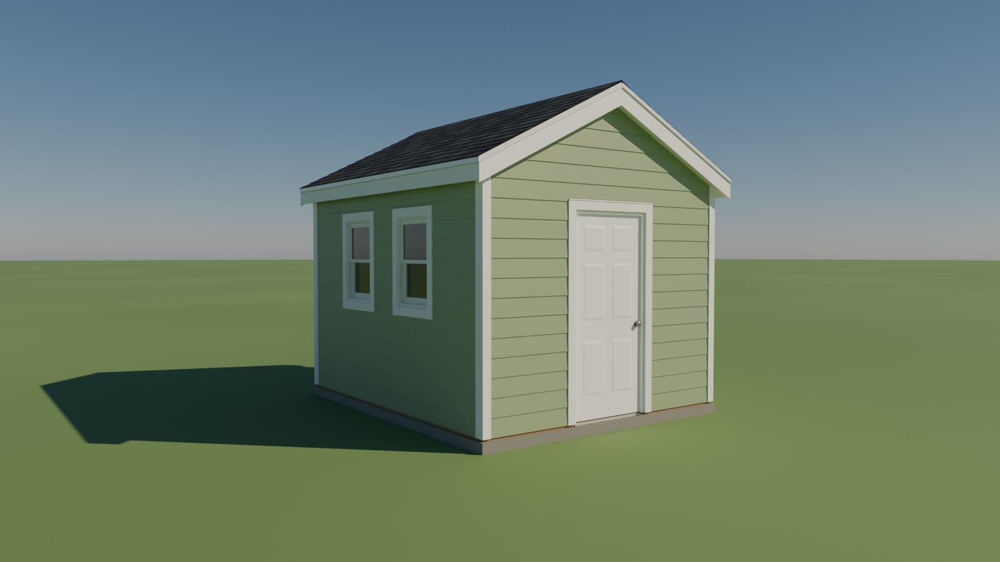
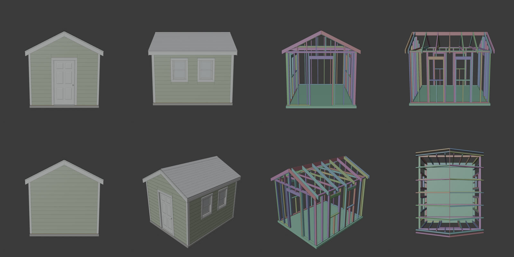

# 027 · Construction-grade shed

| | |
|---|---|
| Track | T7 (build accuracy, then speed; see lab/GOALS.md) |
| Session | cloud (pip bpy 5.2.4, CPU, 4 threads) |
| Date | 2026-11-22 |
| Status | done, with one failed check and one omission waiting for the user (see Result) |

## Question

Can the pilot shed (024, same `brief.md`) be rebuilt at construction grade, which the user asked for ("I still want the detailed accuracy. That's the part that separates me from competitors."): every stud, plate, header, rafter, sheathing panel, siding board and trim piece, a real double-hung window and panel door, a roofer-built roof, with every count coming from a rule, the pitch from the user's approved design rule, and the checks passing?

## Acceptance

Written before any geometry: `acceptance.json`, 120 checks. 93 come from `construction_kit.py -- --plan building.json` (the counts and sizes its rules imply, `source: standard`); 27 from the brief and hand values (`make_acceptance.py`). `roof-expect.json` holds the roof's hand values for `roof_qa.py --expect`.

| What | Target | Tolerance | Source | Checked by |
|---|---|---|---|---|
| Framing counts, per wall | studs (end + layout) front 6, back 8, left 8, right 8; kings 2/4/4; jacks 2/4/4; cripples 2/4/4; headers 2/4/4 members; sills 2/2 (windows); bottom plates 2 (cut at the door) or 1; top plates 2 | exact | standard (R602.3.2, R602.3(5), R602.7) | `acceptance_check.py` `count` |
| Lumber sizes | studs, kings 1.5 x 3.5 x 91.5 in.; jacks 81 in. (door), 78.75 in. (windows); headers 1.5 x 5.5 in.; ridge 0.75 x 7.25 x 154.5 in.; ties 1.5 x 3.5 x 120 in. | 1 mm or 0.1 % | standard (PS 20-20 Table 3) | `size`, each |
| Stud spacing | 16 in. on centre in every unbroken run (9 runs) | 1 mm | given | `spacing` |
| Footprint, wall top | 120 x 144 in.; plate tops at 100 in. (4 in. pad + 96 in.) | 1 mm or 0.1 % | given | `size`, `extent` |
| Roof framing | 18 rafters (7 pairs + 2 barge pairs), 5 ties, 6 + 6 gable studs, ridge top 134.21 in. | exact; 0.1 % | standard (R802.3, R802.4.1(7), R802.5.2.2) | `count`, `extent` |
| Pitch | 6/12 on the rafters and on the roof deck | 0.25 degrees | standard (`pitch.json`, the user's rule) | `slope` |
| Sheathing | 6 pieces on each gable wall (3 panels + 3 gable pieces), 3 on each long wall | exact | standard | `count` |
| Roof | 2 planes, 1.599 squares, eaves 26 ft, rakes 4 x 73.79 in. (24.60 ft), ridge 13 ft; Roof planes 1.5988 sq, eave line 101.40 in., ridge line 134.40 in.; 7 layers (no ice barrier, no ridge vent, no deck repair); covering 110 faces; 384 nails | 2 % (roof_qa); 0.1 %; exact | standard (plan D1, the design rules) | `roof_qa.py --expect`, `area`, `extent`, `count` |
| Siding | courses: gable walls 18, long walls 14; pieces 32 front (cut at the door), 18 back, 32 left and right (cut at windows); a starter strip on each wall (2 on the front) | exact | standard (James Hardie) | `count` |
| Trim | 8 corner boards, 2 fascia, 4 rake boards, 6 soffits | exact | standard | `count` |
| Windows | 4 (brief); each 24 x 36 in. frame, 19 parts, 150+ triangles; centred 4 and 8 ft from the front; heads at 84 in. | exact; 1 mm | given; assumed (positions, heads) | `count`, `size`, `position`, `extent`, `tris` |
| Door | 36 x 80 in. slab, centred at 60 in., 29 parts, 400+ triangles | 1 mm | standard (size), given (centre) | `size`, `position`, `count`, `tris` |
| Materials | sage siding, white trim and casings, asphalt shingles, concrete pad, lumber, glass, white door | names | given; door colour assumed | `material` |
| Hero | 1920 x 1080, not blank | exact | given | `image` |
| Clean mesh | 0 QA errors, complete | none | standard | `qa_check.py --profile render --max-tris 0` |

## Sizes the plan marked as not yet confirmed (D6, decision 4)

Each was looked up before building. Where read:

| Size | Used | Confirmed in | Status |
|---|---|---|---|
| Actual lumber sizes | 2x = 1-1/2 in.; widths 4, 6, 8 = 3-1/2, 5-1/2, 7-1/4 in.; 1x = 3/4 in.; 5/4 = 1 in. | NIST Voluntary Product Standard PS 20-20 (January 2020), Table 3, dry sizes | confirmed |
| Stud size, spacing, height | 2x4 at 16 in.; 91.5 in. studs | IRC Table R602.3(5), read on UpCodes (2024 IRC as adopted by New Jersey): 2x4 bearing wall, roof and ceiling only: 24 in. max spacing, 10 ft max height | confirmed |
| Door rough opening | slab + 2 in. wide, + 2-1/2 in. high (38 x 82-1/2 in.) | Pease Doors, "Door Installation" guide, rough-opening table: 36" x 80" slab, 38" x 82-1/2" | confirmed; other makers list 38 to 38-1/4 x 82 to 82-1/2 in. |
| Window rough opening | unit + 1/2 in. each way (24-1/2 x 36-1/2 in.) | JELD-WEN, "Installation Instructions for Vinyl Flush Fin Windows and Vinyl Windows with Nailing Fin": the window's width and height "are each 1/2" smaller than the rough opening" | confirmed for nailing-fin windows (Windsor uses 3/4 in. in width) |
| Header | two 2x6 on edge | IRC Table R602.7(1) (UpCodes, 2024 IRC): roof and ceiling, 70 psf column (Sioux Falls 55 psf), 12 ft width column (shed 10 ft): 4 ft 6 in., NJ 1; the door needs 38 in. (two 2x4 allow only 3 ft 0 in.) | confirmed |
| Jack and king studs | 1 jack, 1 king each side | R602.7(1) NJ = 1 (above); Table R602.7.5 (Ohio Admin. Code 4101:8-6-01, from the IRC): 1 full-height stud for spans up to 4 ft | confirmed |
| Rafter | 2x6 at 24 in. | IRC Table R802.4.1(7) (UpCodes): ground snow 70 psf, ceiling not attached, L/Δ 180, dead load 10 psf: SPF No. 2 6 ft 11 in., DF-L No. 2 7 ft 0 in., SP No. 2 6 ft 5 in.; this span is about 5 ft (horizontal) | confirmed; species assumed (shortcut 6) |
| Rafter ties, ridge | 2x4 ties at 24 in.; 1x8 ridge, deeper than the 6.15 in. plumb cut | R802.5.2.2 (not less than 2x4, at most 24 in. on centre) and R802.3 (UpCodes) | confirmed |
| Lap siding | 8.25 in. board, 7 in. exposure, 5/16 in. thick; 1-1/4 in. starter; bottom 1 in. above the slab | James Hardie Product Catalog (December 2019): HardiePlank Select Cedarmill and Smooth 8.25 in., 7 in. exposure, 5/16 in.; HardiePlank HZ10 installation instructions (December 2019, Florida approval FL13192): "Install a 1 1/4 in. starter strip to ensure a consistent plank angle"; slabs, paths, steps to siding: min. 1 in. | confirmed |
| Trim, soffit | 5/4 trim 1 in. x 3-1/2 in.; soffit 1/4 in. | James Hardie catalog: HardieTrim 5/4, 1 in. thick, 3.5 in. and up; HardieSoffit, 1/4 in. | confirmed |
| Fascia, rake board | 1x8 (the plan's example said 1x6) | derived: the board must cover the 2x6 tail's plumb cut (6.15 in.) plus the soffit (0.28 in.) less the bevel (0.375 in.), 6.05 in.; a 1x6 is 5.5 in. The kit refuses a 1x6 here. | rule, no product sheet |

Not confirmed (trade practice or common sizes, not read in a primary source; for the user): wall sheathing 7/16 in. OSB in 4 x 8 ft panels (IRC Table R602.3(3) not read; 7/16 in. is also roof_core's deck), gable studs on the wall layout, the door's jamb (3/4 in.), stops (7/16 x 1-1/4 in.), threshold (1 in.), hinge places (7 in. from the top, 11 in. from the bottom), lockset (36 in. up, 2-3/8 in. backset), and the window's frame and sash member sizes (a generic double-hung window, no product sheet).

## Method

From this folder; `PY` = the pip bpy venv, `S` = `.claude/skills/blender-suite/scripts`, `BL` = `python3 $S/build_log.py`, `RB` = `../024-accuracy-first-builds/run_blend.py` (runs a skill script on a saved .blend under pip bpy).

1. Pitch (C1): `python3 $S/roof_pitch.py rule --covering asphalt_shingle --building accessory --out pitch.json` with the user's `lab/data/design-rules.json`: 6/12, source the rule and IRC R905.2.2.
2. `building.json`: the brief's sizes, the sizes above, the design rules (no ice barrier, no ridge vent).
3. `$PY make_acceptance.py` writes `acceptance.json` and `roof-expect.json` before anything is built.
4. `$BL start --name "Garden shed (027, construction grade)" --accept acceptance.json --session cloud`, then every assumption and the omitted parts logged as shortcuts before the first stage.
5. Stages, each followed by an acceptance gate scoped to that stage's checks (`$PY $RB out/shed.blend $S/acceptance_check.py -- --accept acceptance.json --only <ids> > out/gate-X.txt; $BL gate acceptance --result out/gate-X.txt`):
   - `framing`: `$PY $S/construction_kit.py -- --build building.json --only pad walls roof_frame --save out/shed.blend`
   - `sheathing`, `roofing`: `$PY $RB out/shed.blend $S/construction_kit.py -- --build building.json --only sheathing|roofing --save out/shed.blend`; roofing also `$PY ../../tools/roof_qa.py -- --blend out/shed.blend --expect roof-expect.json`
   - `siding`, `trim`, `windows`, `doors`: `$PY $RB out/shed.blend $S/construction_finish.py -- --build building.json --only <stage> --save out/shed.blend`
6. `qa`: `qa_check.py` on every visible mesh, `--profile render --max-tris 0`; then the whole acceptance file but the hero.
7. `look`: `review_shots.py`, material and framing sheets (`img/review.jpg`).
8. `light-camera`: `$PY scene_027.py out/shed.blend` (lawn, the pilot's hero camera, afternoon sun, `Cam_Gable`).
9. `render`: `$PY $RB out/shed.blend $S/render_batch.py -- --engine CYCLES --preset final --res 1920 1080 --device CPU --out //render/hero_####`, gated `--deliverable`; then the full acceptance file.
10. Pitch-from-photo check (C5): the gable rendered from `Cam_Gable` (`render_batch.py ... --cameras Cam_Gable --res 1600 1200 --samples 128`), points read by eye from zoomed crops (`gable-points.json` is the third try; tries 1 and 2 are in `out/`), then `python3 $S/roof_pitch.py photo --image out/render/gable_0001.png --points gable-points.json --overlay out/gable-overlay.png --out pitch-photo.json`.
11. `$BL close --times out/build-times.jsonl`, `$BL report`.

## Result

- **Acceptance: 119 of 120 pass** on the final file (91 standard, 22 given, 7 assumed), 0 forbidden, 0 warnings. The one failure is `nails`: 366 nails built (3,660 faces), 384 by the rule. Cause, found and counted: roof_core.py places nails every 9.84 in. (4 a shingle, R905.2.6) on 12 rows a plane, 192 a plane, but `Plane.contains2(u, v, margin)` applies its 4 cm margin to each of the plane's two triangles, so the 9 nails a plane that fall within 4 cm of the internal diagonal are dropped (hand count: 192 - 9 = 183 a plane, matches). This happens on every roof roof_core builds; fixing it changes the default geometry, which this round had to keep byte-identical, so it is left for the user and the check stays at the rule's 384.
- **QA: 0 errors, complete**: 393 parts, 13,010 triangles, render profile, `--max-tris 0`. 430 warnings, all expected: 386 "no UV map" (the kit's parts carry flat paint colours, no textures), 20 groups of hidden back-to-back faces (parts that touch: a stud on a plate, a knob rose on the slab), 17 duplicate-vertex notes (sheathing panels are merged from convex pieces; roof_core layers), 7 UV notes on roof_core layers. `build_log.py` shows "1 warnings" because the gate line carried the count, not the list.
- **Roof** (`roof_qa.py --expect roof-expect.json`): pass, 2 planes, 1.60 squares (hand 1.599), eaves 25.98 ft (26), rakes 24.61 ft (24.60), ridge 12.99 ft (13); 7 layers, no ice barrier, no ridge vent, no deck repair, as the user's rules say. The covering's 110 faces are explained by rule (14 courses on 2 triangles a plane: 28 course faces + 27 butt faces = 55, x 2) and checked (`covering-faces`).
- **Pitch**: from the user's design rule (`pitch.json`, 6/12, IRC R905.2.2 minimum 2/12); the rafters and the roof deck both measure 26.565 degrees.
- **Pitch from a photo (C5)**: the gable rendered from 25 degrees off square (`img/gable.jpg`), points read by eye from zoomed crops, `roof_pitch.py photo`:

  | Try | Known rectangle | Result | Overlay (look gate) |
  |---|---|---|---|
  | 1 | door slab, 36 x 80 in. | 5.68 ± 0.25, confidence ok | fail: the door lines sat on the casing's inner edge and the head jamb, not the slab (the refiner takes the strongest edge within 18 px; the slab edge is 6 px inside the casing edge). The rectangle was real but the wrong size, so the result was about 5 % low, and the tool's checks could not see it. |
  | 2 | door casing outline, 44.75 x 84.875 in. (36 in. slab + 2 x (1/8 in. gap + 3/4 in. jamb) + 2 x 3.5 in. casing; casing foot 1 in. above the slab to the drip cap's top) | error: no clear edge on the casing's right edge (both edges of the 3.5 in. board inside the search band) | n/a |
  | 3 | same, right-edge clicks 11 px outside the casing | **6.06 ± 0.25/12** (fit 0.028), confidence ok, rakes 6.06 and 6.05 | pass: every line on its edge (`img/gable-overlay.jpg`) |

  Pass: within its own 2 sigma of 6/12, confidence ok. Lessons for `roof-pitch`: a door's slab is not a usable rectangle in a photo (its edges sit just inside stronger jamb and casing edges); use an outline with clean edges whose size is known, and keep each line's clicks on the side away from a parallel edge closer than 18 px. The overlay check caught try 1; without it a 5 % error would have passed as "ok".
- **Construction grade against the pilot**: 393 parts (148 meshes: equal shapes share one mesh) vs 43; 13,010 triangles vs 1,036. Final render, Cycles CPU, 1920 x 1080, 512 samples: **125.7 s** vs the pilot's 101 s. Each build stage took under 0.1 s of compute; the stage times in the report are mostly the builder's own time between commands.





Gates that failed on the way (all in `build_log.json`):
1. Two acceptance gates (stages `sheathing`, `roofing`) ran the whole file instead of the stage's checks: my id filter crashed on the image check, which has no `objects`. They failed on parts not yet built; re-run per stage afterwards, and the whole file passed at the end but for `nails`.
2. The first `look`: the pip bpy startup Cube (with its Camera and Light) stood at the front-left corner. Stage 1 ran in bpy's default scene instead of an empty one. Acceptance missed it (`forbid` is scoped to `Shed_*`) and QA saw no coplanar faces, so only looking caught it. Removed, QA re-run, sheets re-rendered.
3. `pitch-photo` tries 1 and 2, above.

Findings about the tools:
1. The plan's roof test vector said the ridge board is 156 in.; by the rules it is 144 + 2 x (6 - 3/4) = 154.5 in., because the 6 in. overhang is measured to the rake board's face and the ridge runs to the barge rafters' outer faces (the 3/4 in. rake board covers them). The other hand vectors (10 studs of 91.5 in.; 8 full studs, 2 jacks, 2 cripples at 48 and 64; 18 rafters; 14 courses) hold exactly.
2. The plan's example `1x6` fascia and rake board cannot cover a 2x6 rafter tail (6.15 in. plumb) plus the soffit; the kit refuses it and this build uses 1x8.
3. Rafter ties: one beside each of the 5 pairs between the gable walls; the gable walls (top plates, gable studs, sheathing) tie the two end pairs. The plan said a tie per pair (7); a tie on an end pair would clash with the gable studs.
4. roof_core's polygon clipping keeps a corner twice where a clip line passes through it, leaving zero-area slivers; on this shed one tripped `qa_check.py`'s z-fighting test (starter strip). The kit removes them after roofing (`dissolve_degenerate`, 1 micrometre). The default demo has the same slivers; fixing `clip_half` changes the default geometry, so it is not done here.
5. `acceptance_check.py`'s `forbid` only sees the scope it is given; a check for any object outside the building's prefix (other than cameras, lights and the ground) would have caught the startup Cube.

## Shortcuts and assumptions

`build_log.py report` at the final close:

```
Build: Garden shed (027, construction grade) (cloud, 11 min)
Acceptance: 119 of 120 checks pass (acceptance.json 66bca7cc12ae)
  FAIL nails: expected 3840, got 3660
Shortcuts (7):
  1. unverified: Built and checked on the CPU only (cloud, pip bpy 5.2.4); every look gate is the builder's reading of review sheets and the Cycles render; nothing opened in Blender's UI or on a GPU. Why: cloud sub-agent session; the user said CPU is fine for now (024, decision 6), not recorded as an approval here. Effect: the look and the GPU timing are unconfirmed. NOT APPROVED
  2. assumed: Pad 4 in. thick, 2 in. past the framing on each side. Why: not in the brief; the pilot's values. Effect: pad edge shows 2 in. past the walls. Check: pad. NOT APPROVED
  3. assumed: Eave and rake overhangs 6 in., to the fascia and rake-board faces. Why: not in the brief and not in the design rules; the pilot's value. Effect: roof area 1.60 squares, the eave height and the look of the eaves follow from it. Check: roof-area. NOT APPROVED
  4. assumed: Windows centred 4 ft and 8 ft from the front on each long wall, heads 80 in. above the slab (level with the door slab top). Why: the brief gives the count and size, not the positions. Check: window-heads. NOT APPROVED
  5. assumed: Door: 6-panel slab, white like the trim, inswing, hinges on the left seen from outside, knob 36 in. up; siding colour #9CAF88 for sage green. Why: the brief names a door and sage green, not the style, colour, handing or shade. Check: door-material. NOT APPROVED
  6. assumed: Rafter span checked for Spruce-pine-fir No. 2 (2x6 at 24 in., 70 psf column: 6 ft 11 in. allowed, 5 ft needed). Why: no species given; Southern pine No. 2 (6 ft 5 in.) and Douglas fir-larch No. 2 (7 ft 0 in.) pass as well. NOT APPROVED
  7. omitted: Not modelled: house wrap (WRB) and flashing tape; nails and screws in walls and trim; rake lookouts and frieze blocks (hidden behind the soffits); window sash locks and screens. Why: beyond the kit this round; listed in references/construction-detail.md for the user to decide. Effect: a cutaway shows sheathing straight under the siding and open bays above the soffits; windows have no hardware. NOT APPROVED
Assumed values (7): pad: not in the brief: 4 in. slab, 2 in. past the framing (the pilot's values); window-heads: not in the brief: heads line up with the door slab top (4 + 44 + 36 in.); window-1-at: left wall; positions not in the brief: 4 and 8 ft (the pilot's); window-2-at: left wall; positions not in the brief: 4 and 8 ft (the pilot's); window-3-at: right wall; positions not in the brief: 4 and 8 ft (the pilot's); window-4-at: right wall; positions not in the brief: 4 and 8 ft (the pilot's); door-material: door colour not in the brief: white like the trim
Gates: qa pass (0 errors, 1 warnings, complete); look pass; render pass, final 1920x1080 512 samples; look-hero pass; pitch-photo pass
Time: framing 0.2 min, sheathing 0.0 min, roofing 0.7 min, siding 0.0 min, trim 0.0 min, windows 0.0 min, doors 0.2 min, qa 0.3 min, look 0.4 min, fix-startup-objects 0.3 min, light-camera 0.4 min, render 2.6 min, pitch-photo 5.2 min; gates 2.1 min
Done: no (2 blockers); 7 shortcuts await your OK (1, 2, 3, 4, 5, 6, 7)
  - check 'nails' fails (expected 3840, got 3660): fix it, or log a shortcut with --check nails and get the user's yes
  - shortcut 7 is omitted (Not modelled: house wrap (WRB) and flashing tape; nails and screws in walls and trim; rake lookouts and frieze blocks (hidden behind the soffits); window sash locks and screens): a simpler part needs the user's yes (approve 7), or build it in full and resolve 7
```

Timing line (`close --times out/build-times.jsonl`):

```
{"name": "Garden shed (027, construction grade)", "date": "2026-11-22T04:40:37", "session": "cloud", "blender": "5.2.4 LTS", "device": "CPU", "minutes": 10.6, "stages": {"framing": 10.4, "sheathing": 1.4, "roofing": 44.3, "siding": 1.5, "trim": 1.4, "windows": 1.5, "doors": 11.4, "qa": 17.1, "look": 25.2, "fix-startup-objects": 17.2, "light-camera": 23.7, "render": 153.9, "pitch-photo": 311.4}, "gates": {"acceptance": 0.39, "qa": 0, "look": 0, "render": 125.74, "look-hero": 0, "pitch-photo": 0}, "renders": [{"res": [1920, 1080], "samples": 512, "sec_per_image": 125.73, "device": "CPU"}], "tris": 13010, "checks": 120, "passed": 119, "shortcuts": 7, "done": false}
```

Not logged as a shortcut, by the user's choice: individual shingle pieces. The user chose "each shingle a piece" (2026-11-22); it is scheduled as its own experiment (roof_core.py and the web studio together), so this build keeps roof_core's stepped courses and every nail.

## Decision

Keep. The kit and finish scripts build a construction-grade shed whose counts come from rules, checked against the code tables read, and every check but one passes; the failing check found a real defect in the roofer. Open for the user:
1. Approve or reject the omitted parts (shortcut 7: house wrap and flashing tape, wall and trim fasteners, rake lookouts and frieze blocks, window locks and screens), and the assumed values (2 to 6).
2. The nail defect (366 of 384): fix `Plane.contains2` in roof_core.py (the margin should apply to the plane's outline, not each triangle) in its own change, with the default geometry baseline regenerated; the same change can fix the sliver corners in `clip_half`.
3. Individual shingle pieces: the user's choice, its own experiment.
Next (local): rebuild with real Blender on the GPU (`blender -b --factory-startup --python construction_kit.py -- --build building.json --save out/shed.blend`, then the finish script with `run_in_blender.py --blend`), render at 3840x2160, and append the timing line (`out/build-times.jsonl` here) to `lab/build-times.jsonl`.
